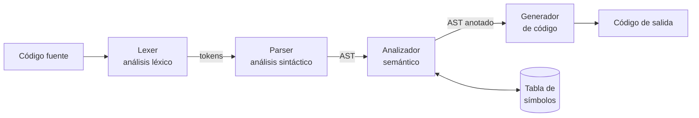

# Compilador


Compilador educativo escrito en **JavaScript** que implementa las fases clásicas de compilación —análisis léxico, sintáctico y semántico, y generación de código— con una **interfaz web** para escribir código fuente y ver el resultado de cada fase.

> 🚧 **Proyecto en desarrollo.** La arquitectura y la estructura de módulos ya están definidas; la implementación de cada fase se está agregando.

---

## Arquitectura



Todas las fases reportarán sus errores a través de un manejador común (`utils/errorHandler.js`).

| Módulo | Archivo | Responsabilidad |
|---|---|---|
| Tokens | [`src/compiler/lexer/tokens.js`](src/compiler/lexer/tokens.js) | Definición de los tipos de token del lenguaje |
| Lexer | [`src/compiler/lexer/lexer.js`](src/compiler/lexer/lexer.js) | Convierte el texto fuente en una secuencia de tokens |
| AST | [`src/compiler/parser/ast.js`](src/compiler/parser/ast.js) | Nodos del árbol de sintaxis abstracta |
| Parser | [`src/compiler/parser/parser.js`](src/compiler/parser/parser.js) | Valida la gramática y construye el AST |
| Tabla de símbolos | [`src/compiler/semantic/symbolTable.js`](src/compiler/semantic/symbolTable.js) | Registro de identificadores, tipos y ámbitos |
| Analizador semántico | [`src/compiler/semantic/analyzer.js`](src/compiler/semantic/analyzer.js) | Verificación de tipos, declaraciones y uso de variables |
| Generador | [`src/compiler/codegen/generator.js`](src/compiler/codegen/generator.js) | Produce el código de salida a partir del AST |
| Errores | [`src/compiler/utils/errorHandler.js`](src/compiler/utils/errorHandler.js) | Reporte uniforme de errores de todas las fases |
| Punto de entrada | [`src/compiler/index.js`](src/compiler/index.js) | Encadena las fases del compilador |
| Interfaz | [`src/gui/`](src/gui/) | Editor web y visualización de tokens, AST y errores |

## Hoja de ruta

- [ ] Definir la gramática del lenguaje fuente
- [ ] Analizador léxico y pruebas (`tests/lexer.test.js`)
- [ ] Analizador sintáctico con construcción del AST y pruebas (`tests/parser.test.js`)
- [ ] Tabla de símbolos y análisis semántico
- [ ] Generación de código
- [ ] Interfaz web con visualización de cada fase

---

## Uso

**Requisitos:** Node.js 20 o superior.

```bash
git clone https://github.com/EdgarPStder/Compilador.git
cd Compilador
npm test            # ejecuta las pruebas con el runner nativo de Node (node --test)
```

La interfaz se abre directamente en el navegador desde `src/gui/index.html`.

## Estructura

```
.
├── src/
│   ├── compiler/
│   │   ├── lexer/        Análisis léxico
│   │   ├── parser/       Análisis sintáctico y AST
│   │   ├── semantic/     Análisis semántico y tabla de símbolos
│   │   ├── codegen/      Generación de código
│   │   ├── utils/        Manejo de errores
│   │   └── index.js
│   └── gui/              Interfaz web (HTML, CSS, JS)
├── tests/                Pruebas unitarias
└── package.json
```

---

## Autor

**Edgar Gael Pesina Santander** — Ingeniería en Sistemas Computacionales, Universidad Autónoma de Tamaulipas.
GitHub: [@EdgarPStder](https://github.com/EdgarPStder)

## Licencia

Código bajo licencia [MIT](LICENSE).
