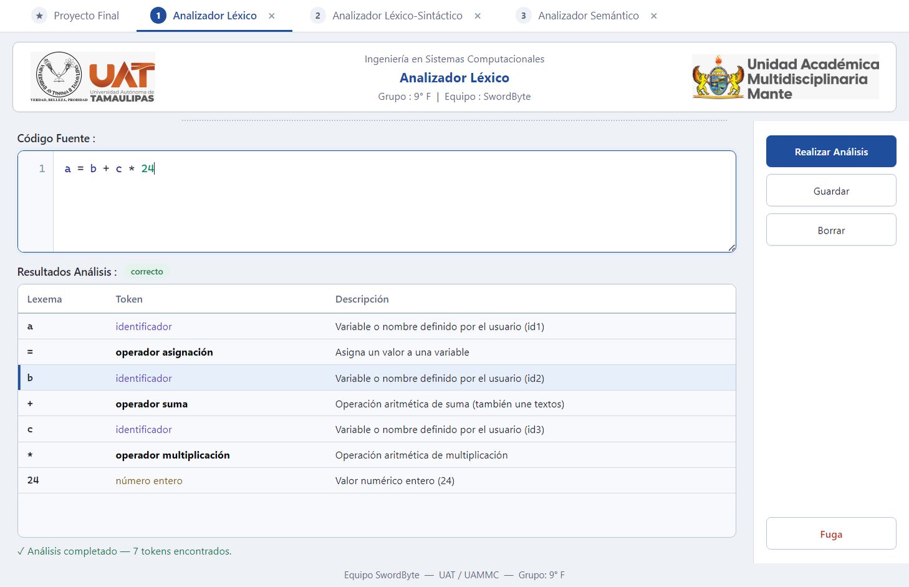
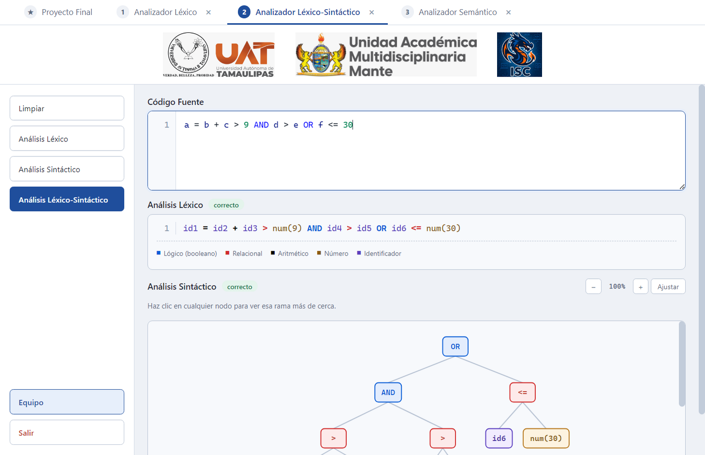
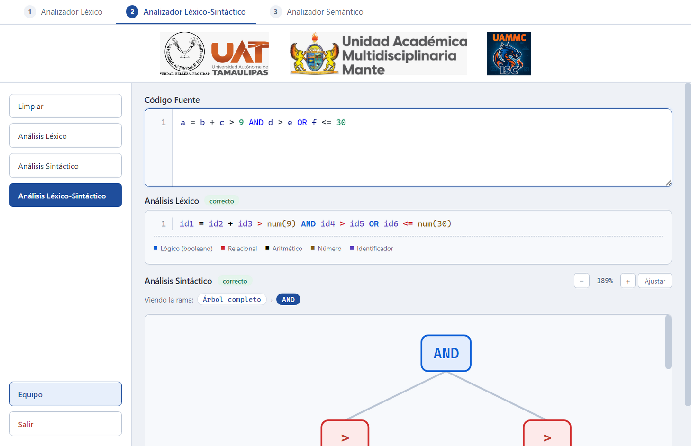
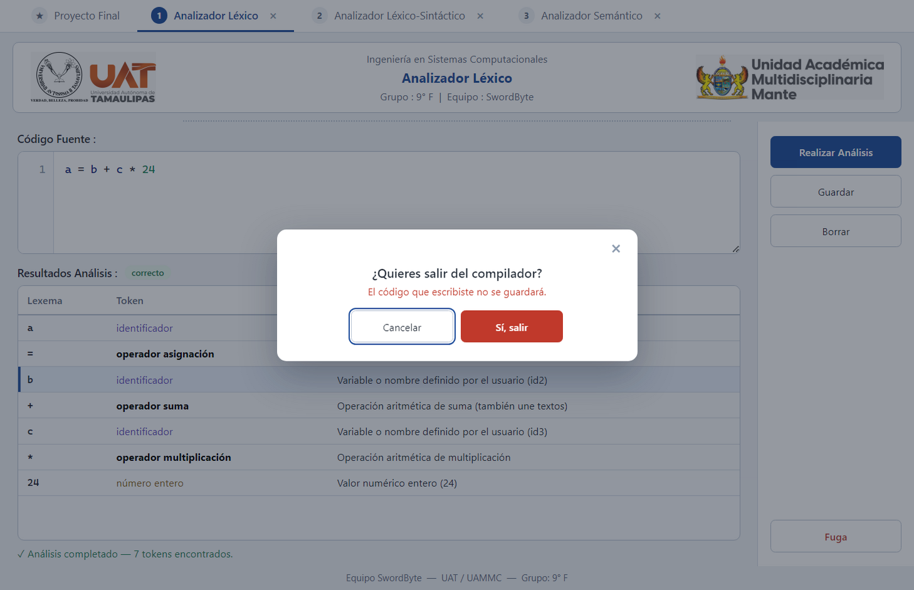
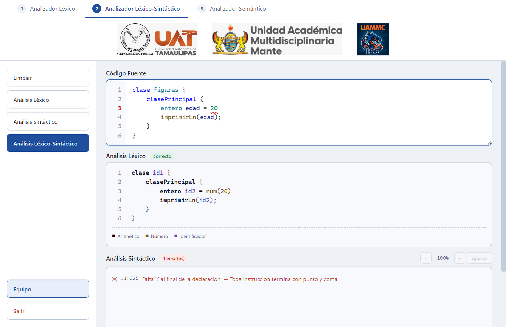
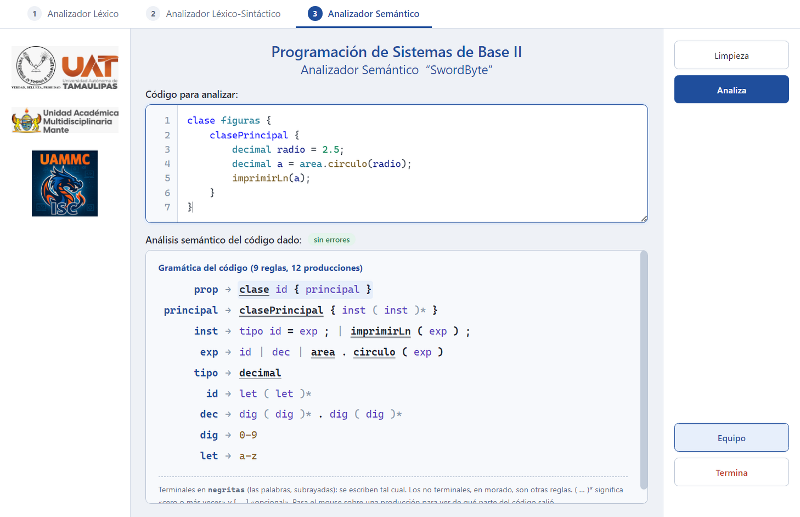
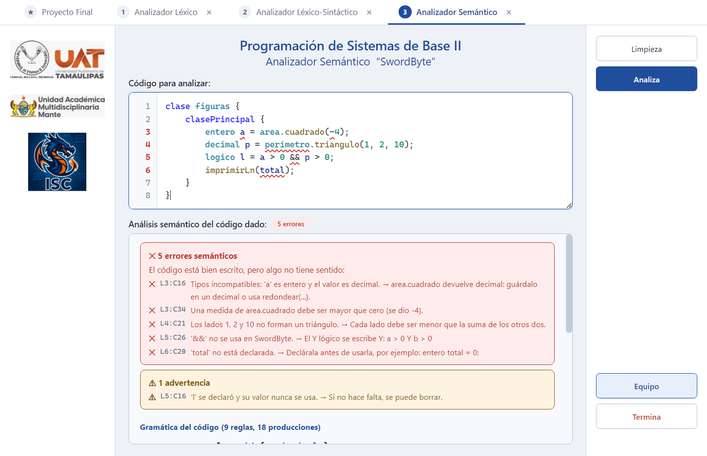
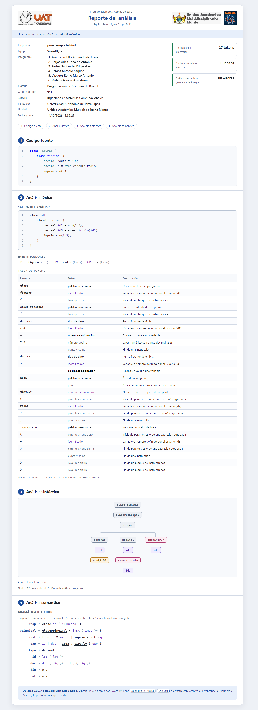

# Compilador SwordByte

[](https://github.com/EdgarPStder/Compilador/releases/latest/download/CompiladorSwordByte-1.0.0-portable.exe)
[](https://github.com/EdgarPStder/Compilador/releases/latest/download/CompiladorSwordByte-1.0.0-instalador.exe)

Compilador del lenguaje de programación **SwordByte**, un lenguaje propio con
sintaxis en español que traduce a Java.

La aplicación de escritorio tiene **cuatro pestañas**: la del **Proyecto Final**
(la que abre al iniciar) y las tres de los analizadores. Todas trabajan sobre el
mismo código:

| Pestaña | Qué muestra |
|---|---|
| **★ · Proyecto Final** | El compilador completo: analiza, compila a Java, guarda la fuente y el compilado |
| **1 · Analizador Léxico** | La tabla de tokens: lexema, token y descripción |
| **2 · Analizador Léxico-Sintáctico** | El código reescrito con los identificadores numerados (`id1 > id2`) y el árbol sintáctico dibujado |
| **3 · Analizador Semántico** | Que el programa tenga sentido: sus errores semánticos (nombres sin declarar, tipos que no coinciden…) y la gramática del código |



---

## Descargar

Los dos ejecutables están publicados en
[**Releases**](https://github.com/EdgarPStder/Compilador/releases/latest). Se
descargan con un clic, sin instalar nada más:

| Versión | Descarga directa | Para qué sirve |
|---|---|---|
| **Portable** | [CompiladorSwordByte-1.0.0-portable.exe](https://github.com/EdgarPStder/Compilador/releases/latest/download/CompiladorSwordByte-1.0.0-portable.exe) | Un solo `.exe` de 72 MB: doble clic y se ejecuta; no instala ni deja rastro |
| **Instalador** | [CompiladorSwordByte-1.0.0-instalador.exe](https://github.com/EdgarPStder/Compilador/releases/latest/download/CompiladorSwordByte-1.0.0-instalador.exe) | Instala el programa con acceso directo en el menú Inicio y en el escritorio |

> **Windows puede mostrar «Windows protegió su PC»** porque el ejecutable no
> está firmado con un certificado comercial. Elige **Más información → Ejecutar
> de todas formas**.

---

## Qué hace

| | |
|---|---|
| **Lenguaje** | SwordByte, archivos `.bs` |
| **Destino** | Java |
| **Analizadores** | 1. Léxico · 2. Léxico-sintáctico · 3. Semántico |
| **Implementado en** | JavaScript (Node.js + Electron) |
| **Entregable** | `.exe` portable e instalador para Windows |

---

## El ejemplo de siempre

| | |
|---|---|
| **Código fuente** | `a > b` |
| **Análisis léxico** | `id1 > id2` |
| **Análisis sintáctico** | ver el árbol |

```
          >
        /   \
     id1     id2
```

En el análisis léxico cada identificador recibe una etiqueta `id1`, `id2`,
`id3`… en el orden en que aparece, y cada número se muestra como `num(valor)`:

| Código fuente | Análisis léxico |
|---|---|
| `a > b` | `id1 > id2` |
| `a + a + b` | `id1 + id1 + id2` |
| `entero edad = 20;` | `entero id1 = num(20);` |

Los operadores se colorean por categoría: **lógicos en azul**, **relacionales
en rojo** y **aritméticos en negro**, los mismos colores que usan los nodos del
árbol.

---

## La jerarquía de operadores

El árbol se dibuja de verdad, con la raíz arriba y las ramas colgando, así que
su forma **es** la jerarquía:

| Grupo | Operadores | Dónde queda |
|---|---|---|
| 1. **Booleanos** | `Y AND &&` · `O OR \|\|` · `NO NOT !` | hasta arriba |
| 2. **Relacionales** | `==` `!=` `<` `<=` `>` `>=` | en medio |
| 3. **Aritméticos** | `=` · `+` `-` · `*` `/` `%` · `-` `+` `√` unarios · `^` `**` · `id` `num` | hasta abajo |

Los **paréntesis** reinician la jerarquía: dentro de `( )` puede ir cualquier
expresión, así que sirven para forzar otro orden. `a > b AND c` pone el `AND`
arriba, pero `a > (b AND c)` pone el `>` arriba.

Para `a = b + c > 9 AND d > e OR f <= 30`:

```
                    OR                     <-- 1. BOOLEANOS
                 /      \
              AND        <=                <-- 2. RELACIONALES
            /     \     /    \
           >       >  id6  num(30)
         /   \   /   \
        =  num(9) id4 id5                  <-- 3. ARITMETICOS
      /   \
    id1    +
         /   \
       id2   id3
```

No hace falta punto y coma: una expresión suelta se analiza tal cual.



Un clic en cualquier nodo deja en pantalla sólo esa rama, ya agrandada, con el
camino para regresar:



Cada operador lógico admite sus tres formas:

| Operación | Formas válidas |
|---|---|
| Y lógico | `Y` · `AND` · `&&` |
| O lógico | `O` · `OR` · <code>&#124;&#124;</code> |
| Negación | `NO` · `NOT` · `!` |

La potencia y la raíz quedan **por debajo** de `*` `/` `%`, así que se resuelven
primero: `2 * 3 ^ 2` es `2 * (3 ^ 2) = 18`. También admiten varias formas:

| Operación | Formas válidas |
|---|---|
| Potencia | `2 ^ 10` · `2 ** 10` · `potencia(2, 10)` |
| Raíz cuadrada | `√16` · `raiz(16)` · `raizCuadrada(16)` |
| Raíz n-ésima | `raiz(27, 3)` |
| Raíz cúbica | `raizCubica(27)` |


---

## Inicio rápido

### Usar el ejecutable

Descarga el [**portable**](https://github.com/EdgarPStder/Compilador/releases/latest/download/CompiladorSwordByte-1.0.0-portable.exe)
y haz doble clic: no requiere instalación. Si prefieres instalarlo, usa el
[**instalador**](https://github.com/EdgarPStder/Compilador/releases/latest/download/CompiladorSwordByte-1.0.0-instalador.exe).

### Ejecutar desde el código

```bash
npm install
npm start
```

### Correr las pruebas

```bash
npm run pruebas       # 152 pruebas del compilador
npm run pruebas:ui    # 179 comprobaciones sobre la aplicación
```

### Generar el ejecutable

```bash
npm run dist
```

---

## La ventana

Hasta arriba van **las cuatro pestañas**. Se cambia con un clic, con `Ctrl+0` /
`Ctrl+1` / `Ctrl+2` / `Ctrl+3` o con `Ctrl+Tab`. La aplicación abre en la
pestaña del proyecto final; las tres de los analizadores quedan ocultas y se
abren desde el menú **Ver**.

**Cada pestaña conserva su propio diseño**, con sus logos y sus botones donde
los pide ese diseño. Lo que comparten es el estilo (los colores, los botones y
las cajas del analizador léxico-sintáctico):

| Pestaña | Logos | Botones |
|---|---|---|
| **★ · Proyecto Final** | Los tres arriba (UAT, UAMM, ISC) | Analiza lexico · Analiza sintactico · Analiza semantico · **Compila** · Carga Archivo · Guardar fuente · Guardar Compilado · Limpiar · Equipo · Salir |
| **1 · Léxico** | UAT a la izquierda y UAMM a la derecha; en medio, la carrera, el analizador, el grupo y el equipo | A la derecha: Realizar Análisis · Guardar · Borrar · **Fuga** |
| **2 · Léxico-Sintáctico** | Los tres arriba (UAT, UAMM, ISC) | A la izquierda: Limpiar · Análisis Léxico · Análisis Sintáctico · Análisis Léxico-Sintáctico · Equipo · Salir |
| **3 · Semántico** | Los tres en columna, a la izquierda | A la derecha: Limpieza · Analiza · Equipo · Termina |

En la pestaña final, el código fuente ocupa **1/3** del ancho y el resultado
**2/3**. **Compila** muestra únicamente el código Java generado. **Guardar
fuente** crea `<clase>/<clase>.sb` y **Guardar Compilado** crea
`<clase>/<clase>.java`, ambos dentro de la carpeta que se elija.

**Fuga**, **Salir** y **Termina** abren la misma ventana con la pregunta
*¿Quieres salir del compilador?*



### Los cuadros de código

Los cuadros donde se escribe llevan **números de renglón** y los
**colores de Java** que usa VS Code (tema *Light+*), mientras se escribe: el
control de flujo (`si`, `para`, `retornar`) en morado, los tipos y las clases
(`entero`, `area`) en verde azulado, `clase`, `funcion` y `verdadero` en
azul, las funciones en café, las variables en azul marino, los números en
verde, los textos en rojo oscuro y los comentarios en verde. Con mucho código
el cuadro no se estira: se desplaza por dentro. La salida del análisis léxico
de la pestaña 2 va numerada igual: el renglón 3 del análisis es el renglón 3
del código.

Al dejar de escribir medio segundo, **los errores se subrayan en rojo**, con
el número de su renglón también en rojo; al pasar el mouse sobre ese renglón
se ve el mensaje. Cada pestaña marca los errores de su fase y de las
anteriores.



### Las cuatro pestañas comparten el código

- Lo que se escribe en una pestaña aparece al momento en las otras tres.
- Al analizar en cualquiera, **se llenan las cuatro**: si analizas en la pestaña 1
  y pasas a la 2, el árbol ya está dibujado.
- **Cambiar de pestaña no borra nada**: la tabla, la fila marcada, la rama
  abierta del árbol y el zoom siguen ahí al regresar.
- Sólo Borrar / Limpiar / Limpieza vacían el código, en las cuatro a la vez.

El árbol de la pestaña 2 se puede **acercar y alejar** con los botones `−` /
`+` de su encabezado, con **Ajustar** (lo encaja al ancho) o con
**Ctrl + rueda** del mouse, sin perder de vista lo que se estaba viendo. Un
árbol ancho (un programa completo) se dibuja de su tamaño real, con la raíz
centrada, y se puede recorrer hacia los dos lados.

La aplicación **abre en blanco, en la pestaña del proyecto final**. Para empezar: escribe el
código, elige uno del menú **Ejemplos**, abre un archivo con `Ctrl+O` o
arrástralo a la ventana.

Las cuatro pestañas trabajan con el mismo lenguaje y las mismas reglas. Como en
Java, **el código va dentro de una clase** (`clase p { clasePrincipal { ... } }`):
unas instrucciones sueltas son un error, *Falta la clase*. Para practicar la
forma, las pestañas 1 y 2 aceptan también expresiones sueltas, una por renglón
y sin punto y coma (`a = b + c`, `a && b || c + f > d`). La aplicación detecta
sola qué se escribió.

El análisis sintáctico sólo reconoce las **instrucciones del lenguaje**. El
lenguaje está basado en Java, así que si se escribe una palabra de Java
(`break`, `int`, `System.out.println`…), el error dice cuál es la de
SwordByte (`romper`, `entero`, `imprimirLn`…).

### El analizador semántico



Le das un **programa SwordByte** y revisa que **tenga sentido**, como lo haría
un compilador de Java:

- cada nombre debe estar **declarado** antes de usarse, y no repetirse;
- los **tipos** deben coincidir (`entero x = "hola";` es error; un `decimal`
  no cabe en un `entero`);
- las condiciones deben ser lógicas, una `Constante` no cambia, `romper` va
  dentro de un ciclo, una función devuelve lo que dice…;
- las reglas de **geometría**: medidas mayores que cero, lados que formen
  un triángulo, `area.circulo(…)` devuelve `decimal`;
- y lo que es del lenguaje: la lógica se escribe con `Y`, `O` y `NO`, y las
  potencias y las raíces con `potencia(base, exponente)` (`&&`, `^`, `√`,
  `raiz`… sólo se aceptan en las pestañas 1 y 2, para practicar).

Muestra los **errores** y, aparte, las **advertencias** (como variables que
nunca se usan) —si no hay errores, lo dice la insignia— y la **gramática del
código**, como en el pizarrón. Para el ejemplo del pizarrón dentro de su
clase, `clase p { clasePrincipal { a1 = b5 / 20; } }`:

```
prop      → clase id { principal }
principal → clasePrincipal { inst }
inst      → id = exp ;
exp       → id | num | exp / exp
id        → let ( dig )*
num       → dig ( dig )*
dig       → 0-9
let       → a-z
```

La **tabla de símbolos** y el **manejo de errores** no son sólo del
semántico: como en el esquema clásico de un compilador, los usan las tres
fases (`src/core/comun/`).



Detalles, con cada regla y su mensaje, en
[08 — Analizador semántico](docs/08-analizador-semantico.md).

### Guardar

**Guardar** (pestaña 1), `Ctrl+S` o **Archivo → Guardar reporte** guardan un
**reporte visual**: una página web (`.html`) que se abre con doble clic en
cualquier navegador. Como en Java, **el archivo se llama igual que la clase**:
`clase ejemplo` se guarda como `ejemplo.html`.



- Trae el encabezado (equipo, integrantes, materia, grado y grupo, fecha y
  hora), el **código fuente**, la **tabla de tokens**, el **árbol dibujado** y
  la **gramática generada**, con los mismos colores que la aplicación.
- Es **un solo archivo**: los logos y los estilos van adentro. Se imprime o se
  pasa a PDF con `Ctrl+P` desde el navegador.
- **Se puede volver a poner en el compilador**: ábrelo con `Ctrl+O` o
  arrástralo a la ventana. Regresa el código a las tres pestañas y vuelve a la
  pestaña desde la que se guardó.

En el diálogo también se puede elegir el **reporte en texto** (`.bs`) de antes,
que sigue siendo un programa SwordByte válido. Detalles de los dos en el
[manual](docs/06-manual-de-usuario.md#12-guardar-y-volver-a-abrir).

### Cambiar los logos

Los logos viven en `src/ui/img/` como `logo-uat.jpeg`, `logo-uamm.jpeg` y
`logo-isc.jpeg`. Para cambiar alguno, copia ahí la imagen nueva **con el mismo
nombre**. Cada logo se escala para caber en el encabezado sin deformarse, así
que sirven tanto los apaisados como los cuadrados.

---

## Un programa en SwordByte

```swordbyte
clase bienvenida {

    funcion entero sumar(entero a, entero b) {
        retornar a + b;
    }

    clasePrincipal {
        equipo(Null);

        entero edad = 20;
        cadena nombre = "SwordByte";

        si (edad >= 18 Y edad < 100) {
            imprimirLn("Mayor de edad");
        } sino {
            imprimirLn("Menor de edad");
        }

        para (entero i = 1; i <= 3; i++) {
            imprimirF("Vuelta %d", i);
        }

        imprimirLn(sumar(5, 3));
    }
}
```

Su equivalente en Java sería:

```java
public class bienvenida {
    static int sumar(int a, int b) { return a + b; }

    public static void main(String[] args) {
        // equipo(Null) genera los System.out.println del equipo
        int edad = 20;
        String nombre = "SwordByte";

        if (edad >= 18 && edad < 100) {
            System.out.println("Mayor de edad");
        } else {
            System.out.println("Menor de edad");
        }

        for (int i = 1; i <= 3; i++) {
            System.out.printf("Vuelta %d", i);
        }

        System.out.println(sumar(5, 3));
    }
}
```

---

## Documentación

Dentro de la aplicación, **F1** o **Ayuda → Documentación** abre tres manuales
integrados (no son archivos Markdown): **Manual de usuario**, **Manual técnico**
y **Documentación del lenguaje** (sintaxis, funciones, biblioteca estándar y
buenas prácticas).

Los archivos de esta carpeta son la documentación de desarrollo del proyecto:

| Documento | Contenido |
|---|---|
| **[00 — Manual técnico](docs/00-manual-tecnico.md)** | **Empieza aquí.** El proyecto completo de lo general a lo particular: qué es un compilador, el lenguaje, la arquitectura, los tres analizadores por dentro, la aplicación y el mantenimiento |
| [01 — Especificación del lenguaje](docs/01-especificacion-del-lenguaje.md) | Alfabeto, palabras reservadas, tipos, todas las instrucciones y su equivalente en Java |
| [02 — Analizador léxico](docs/02-analizador-lexico.md) | El AFD, sus 19 estados, las categorías de token, la salida `id1 > id2` y los errores léxicos |
| [03 — Analizador sintáctico](docs/03-analizador-sintactico.md) | Descenso recursivo, los tres modos de análisis, precedencia, recuperación de errores y el árbol |
| [04 — Gramática EBNF](docs/04-gramatica-ebnf.md) | La gramática formal completa |
| [05 — Arquitectura](docs/05-arquitectura.md) | Estructura de carpetas y decisiones de diseño |
| [06 — Manual de usuario](docs/06-manual-de-usuario.md) | Cómo usar la aplicación: la pestaña final, las tres pestañas y guardar y volver a abrir |
| [07 — Mantenimiento](docs/07-mantenimiento.md) | Cómo agregar instrucciones, cambiar datos y empaquetar |
| [08 — Analizador semántico](docs/08-analizador-semantico.md) | Las reglas que revisa la pestaña 3, la tabla de símbolos que comparten las tres fases, los tipos y la gramática del código |

---

## Estructura del proyecto

```
Compilador/
├── src/core/         El compilador (JavaScript puro, sin dependencias)
│   ├── 01.lexico/        Fase 1 — tokens, la tabla y la salida id1/num()
│   ├── 02.sintactico/    Fase 2 — gramática, parser y árbol
│   ├── 03.semantico/     Fase 3 — nombres, tipos y la gramática
│   ├── ReporteHTML.js    El reporte visual que se guarda y se vuelve a abrir
│   └── comun/            Lo que usan las 3 fases: tabla de símbolos, errores, tokens y datos del equipo
├── src/ui/           Interfaz gráfica: la pestaña final y las tres de los analizadores (incluye img/ con los logos)
├── electron/         Aplicación de escritorio
├── ejemplos/         Programas .bs de demostración
├── pruebas/          Pruebas automáticas
└── docs/             Documentación
```

---

## Ejemplos incluidos

| Archivo | Qué demuestra |
|---|---|
| [`01-equipo.bs`](ejemplos/01-equipo.bs) | La instrucción `equipo` |
| [`02-variables.bs`](ejemplos/02-variables.bs) | Todos los tipos de dato y las constantes |
| [`03-control.bs`](ejemplos/03-control.bs) | `si`/`sinoSi`/`sino`, los tres ciclos y `opcion` |
| [`04-funciones.bs`](ejemplos/04-funciones.bs) | Funciones con y sin retorno |
| [`05-completo.bs`](ejemplos/05-completo.bs) | Arreglos, matrices, entrada, errores y funciones nativas |
| [`06-potencias-y-raices.bs`](ejemplos/06-potencias-y-raices.bs) | Potencias y raíces con `potencia(base, exponente)`: la raíz cuadrada es `potencia(x, 0.5)` |
| [`07-con-errores.bs`](ejemplos/07-con-errores.bs) | Errores a propósito, para ver el reporte |

Se abren con `Ctrl+O` desde la aplicación.

---

## Comandos disponibles

| Comando | Qué hace |
|---|---|
| `npm start` | Abre la aplicación |
| `npm run pruebas` | Pruebas del compilador |
| `npm run pruebas:ui` | Comprobaciones sobre la aplicación |
| `npm run dist` | Genera los ejecutables en `dist/` |
| `npm run icono` | Regenera el icono de la aplicación |
| `npm run capturas` | Regenera las capturas de la documentación (las tres pestañas, Fuga y el reporte) |
| `npm run gramatica` | Regenera `docs/04-gramatica-ebnf.md` desde `Gramatica.js` |

---

## Equipo

**SwordByte**

1. Ávalos Castillo Armando de Jesús
2. Borjas Arias Ronaldo Antonio
3. Pesina Santander Edgar Gael
4. Ramos Antonio Saqueo
5. Vázquez Romo Marco Antonio
6. Verlage Aceves Axel Aram

## Autor

**Edgar Gael Pesina Santander** — Ingeniería en Sistemas Computacionales, Universidad Autónoma de Tamaulipas.
GitHub: [@EdgarPStder](https://github.com/EdgarPStder)

## Licencia

Código bajo licencia [MIT](LICENSE).
