# Manual de usuario

Guía de uso de la aplicación **Compilador SwordByte**.

---

## 1. Instalación

### Opción A — Ejecutable portable (no requiere instalar nada)

1. Copia `CompiladorSwordByte-1.0.0-portable.exe` a donde quieras.
2. Doble clic. La aplicación abre directamente.

Es un solo archivo: sirve para llevarlo en una USB o entregarlo tal cual.

### Opción B — Instalador

1. Ejecuta `CompiladorSwordByte-1.0.0-instalador.exe`.
2. Elige la carpeta de instalación.
3. Se crea un acceso directo en el escritorio.

### Opción C — Desde el código fuente

```bash
npm install
npm start
```

---

## 2. La ventana

Hasta arriba están **las seis pestañas**, una por fase. Debajo, la
pestaña que se está viendo, **cada una con su propio diseño**: sus logos, sus
botones y sus cuadros van donde los pide su diseño.

| Pestaña | Diseño | Logos | Botones |
|---|---|---|---|
| **1 · Analizador Léxico** | El de la captura del analizador léxico | UAT a la izquierda y UAMM a la derecha, con la carrera, el analizador, el grupo y el equipo en medio | A la derecha |
| **2 · Analizador Léxico-Sintáctico** | El anterior | Los tres (UAT, UAMM, ISC) arriba | A la izquierda |
| **3 · Analizador Semántico** | El del pizarrón | Los tres en columna, a la izquierda | A la derecha |
| **4 · Código Intermedio** | El de la pestaña 3 | Los tres en columna, a la izquierda | A la derecha |
| **5 · Optimización** | El de la pestaña 3 | Los tres en columna, a la izquierda | A la derecha |
| **6 · Código Objeto** | El de la pestaña 3 | Los tres en columna, a la izquierda | A la derecha |

Lo que comparten las seis es el **estilo**: los colores, los botones, las cajas
y los tipos de letra son los del analizador léxico-sintáctico.

Para cambiar de pestaña: un clic en ella, `Ctrl+1` a `Ctrl+6`, o
`Ctrl+Tab` para pasar a la siguiente (`Ctrl+Shift+Tab` regresa).

> Lo que aparece dentro de los cuadros en los diseños (`a = b + c * 24`,
> `w = x + 3 > y`, `switch a case 1: …`) es sólo un ejemplo: se puede escribir
> cualquier código del lenguaje.

### Los cuadros de código: números, colores y errores

Los tres cuadros donde se escribe el código tienen:

- **Números de renglón** a la izquierda. Se mueven junto con el texto cuando el
  cuadro se desplaza, así que el número siempre queda a la altura de su
  renglón. Con mucho código el cuadro **no se estira**: mantiene su alto y se
  desplaza por dentro.
- **Los colores de Java**, los mismos que usa VS Code para Java (tema
  *Light+*), que se ponen mientras se escribe. Como SwordByte está basado en
  Java, cada palabra lleva el color de su equivalente:

| Qué | Color | SwordByte | En Java |
|---|---|---|---|
| Control de flujo | morado | `si`, `sino`, `para`, `mientras`, `opcion`, `caso`, `romper`, `retornar`, `intentar` | `if`, `for`, `return`… |
| Tipos de dato y clases | verde azulado | `entero`, `decimal`, `cadena`, `area`, `perimetro`, `Error`, el nombre de la clase | `int`, `double`, `String`, `Math` |
| Declaraciones, constantes y operadores con palabra | azul | `clase`, `funcion`, `Constante`, `Arreglo`, `verdadero`, `Null`, `Y`, `NO` | `class`, `final`, `true` |
| Funciones | café | `imprimirLn`, `potencia`, `circulo`, `sumar(…)` | `println`, `pow` |
| Variables | azul marino | `edad`, `radio` | |
| Números | verde | `20`, `3.5` | |
| Textos y caracteres | rojo oscuro | `"Hola"`, `'A'` | |
| Comentarios | verde | `// nota`, `/* … */` | |
| Errores léxicos | subrayados en rojo | un `@`, una cadena sin cerrar | |

Los colores salen del mismo analizador léxico de la pestaña 1: lo que se pinta
como palabra del lenguaje es exactamente lo que ahí se llama *palabra
reservada* o *tipo de dato*.

- **El subrayado rojo de los errores**, como en un editor de Java. Cuando
  dejas de escribir medio segundo, el código se revisa y cada error queda
  subrayado en rojo, con el número de su renglón también en rojo. **Pasa el
  mouse sobre ese renglón** para ver el mensaje y la sugerencia. Mientras
  escribes no se subraya nada (el código está a medias).

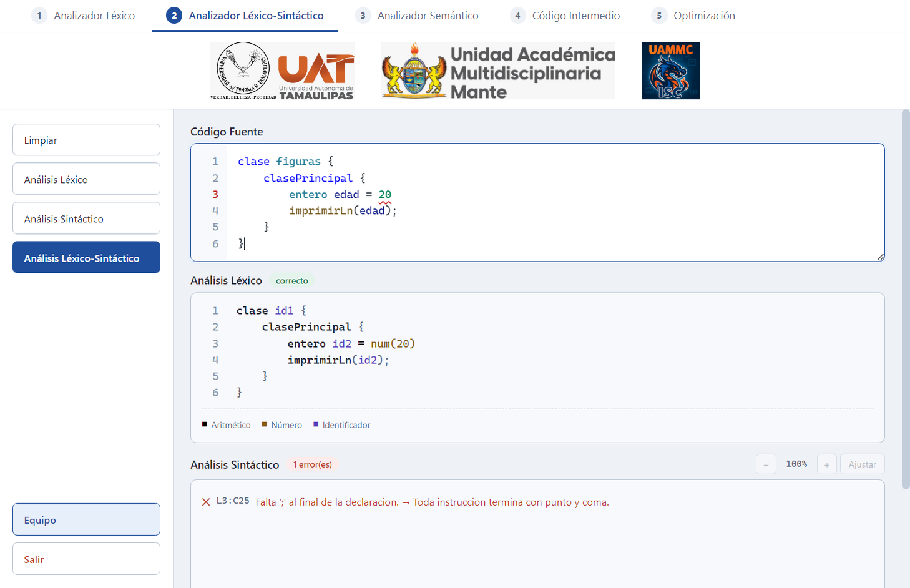

Cada pestaña subraya los errores de su análisis y los de las fases que van
antes: la 1, los léxicos; la 2, los léxicos y los sintácticos (por ejemplo,
*Falta la clase* o un `;` que falta); la 3, los de las tres fases.

---

## 2 bis. Al abrir la aplicación

La aplicación **abre en blanco y en la pestaña 1**. Hay cuatro formas de
empezar:

1. **Escribir** el código en el cuadro.
2. **Menú Ejemplos** → elegir uno de los programas incluidos. Se carga y se
   analiza solo.
3. **Archivo → Abrir** (`Ctrl+O`) → abrir un reporte `.html`, un `.bs` o un
   `.txt` guardado antes.
4. **Arrastrar** uno de esos archivos sobre la ventana.

---

## 3. Las seis pestañas trabajan juntas

Las seis pestañas comparten **el mismo código**:

- Lo que escribes en una pestaña aparece al momento en las demás.
- Al analizar desde cualquier pestaña se analiza todo de una vez. Si analizas
  en la pestaña 1 y pasas a la 2, el árbol **ya está dibujado**; si pasas a la
  3, la gramática **ya está generada**; si pasas a la 6, el Java **ya está
  escrito**.
- **Cambiar de pestaña no borra nada.** Al regresar sigue ahí la tabla, la fila
  que marcaste, la rama del árbol que abriste y el zoom.
- Sólo **Borrar**, **Limpiar** o **Limpieza** vacían el código, y lo vacían en
  las seis pestañas.

Todas trabajan con **el mismo lenguaje (SwordByte) y las mismas reglas**: lo
que es correcto en una es correcto en las otras.

---

## 4. Pestaña 1 — Analizador Léxico

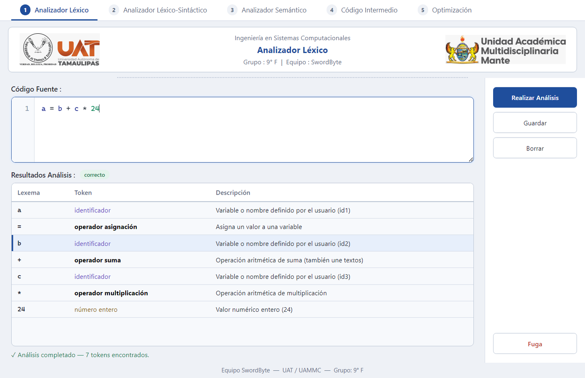

Arriba, en un recuadro: el logo de la UAT, *Ingeniería en Sistemas
Computacionales · Analizador Léxico · Grupo : 9° F | Equipo : SwordByte* y el
logo de la UAMM. Abajo de todo, el pie *Equipo SwordByte — UAT / UAMMC —
Grupo: 9° F*.

| Botón | Qué hace |
|---|---|
| **Realizar Análisis** | Analiza el código y llena la tabla (y las demás pestañas) |
| **Guardar** | Guarda el reporte, igual que `Ctrl+S` (ver la sección 12) |
| **Borrar** | Vacía el código y los resultados de las seis pestañas |
| **Fuga** | Muestra al equipo y pregunta si quieres salir (sección 11) |

La tabla **Resultados Análisis** tiene un renglón por token, en el orden en que
aparecen en el código:

| Columna | Qué dice | Ejemplo |
|---|---|---|
| **Lexema** | El texto tal como está en el código | `+` |
| **Token** | Qué es, con su nombre específico | operador suma |
| **Descripción** | Para qué sirve | Operación aritmética de suma |

Para `a = b + c * 24`:

| Lexema | Token | Descripción |
|---|---|---|
| `a` | identificador | Variable o nombre definido por el usuario (id1) |
| `=` | operador asignación | Asigna un valor a una variable |
| `b` | identificador | Variable o nombre definido por el usuario (id2) |
| `+` | operador suma | Operación aritmética de suma (también une textos) |
| `c` | identificador | Variable o nombre definido por el usuario (id3) |
| `*` | operador multiplicación | Operación aritmética de multiplicación |
| `24` | número entero | Valor numérico entero (24) |

- El identificador dice entre paréntesis su etiqueta (`id1`, `id2`…), la
  misma que usa la pestaña 2.
- El nombre del token va del mismo color que en la pestaña 2: los lógicos en
  azul, los relacionales en rojo y los aritméticos en negro.
- Un **error léxico** sale como un renglón rojo con el mensaje del error.
- Un clic en un renglón lo deja **marcado**, para señalarlo al explicar. Al
  pasar el mouse se ve en qué línea y columna del código está.

Debajo de la tabla, la línea de estado dice cómo terminó:

```
a = b + c * 24     ✓ Análisis completado — 7 tokens encontrados.
entero a = 4.;     ✕ Análisis con 1 error léxico — 5 tokens encontrados.
```

---

## 5. Pestaña 2 — Analizador Léxico-Sintáctico

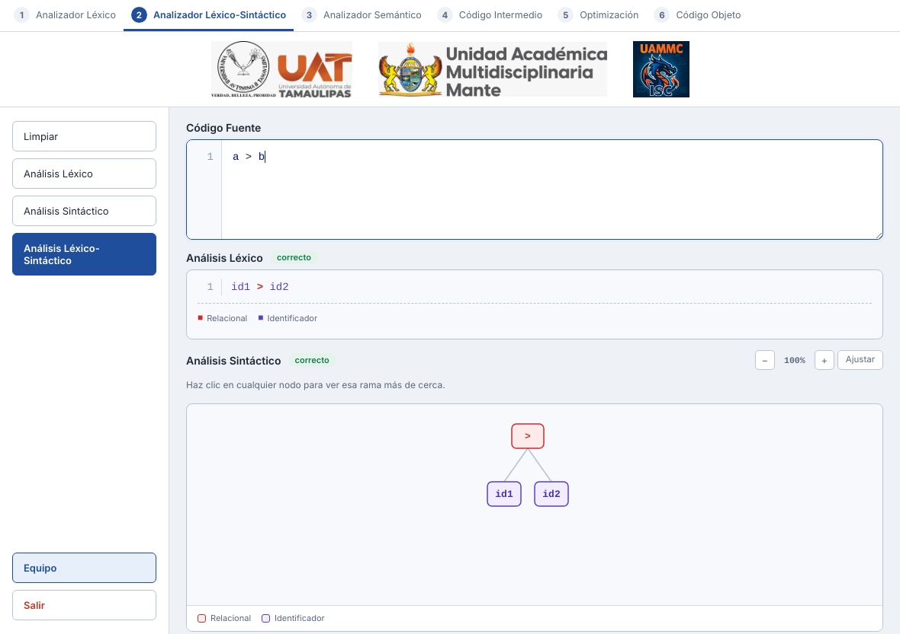

Es la pantalla de la entrega anterior, tal cual: los tres logos arriba y los
botones a la izquierda.

| Botón | Qué hace |
|---|---|
| **Limpiar** | Vacía el código y los resultados de las seis pestañas |
| **Análisis Léxico** | Llena sólo el cuadro de análisis léxico |
| **Análisis Sintáctico** | Dibuja sólo el árbol |
| **Análisis Léxico-Sintáctico** | Llena los dos cuadros |
| **Equipo** | Abre la ventana con los integrantes |
| **Salir** | Muestra al equipo y pregunta si quieres salir |

Cualquiera de los tres botones de análisis también llena las pestañas 1 y 3.

---

## 6. Pestaña 2: qué muestra el Análisis Léxico

El analizador sustituye cada identificador por una etiqueta `id1`, `id2`,
`id3`… en el orden en que aparecen, y envuelve cada número como `num(valor)`.
El resto —palabras reservadas, operadores y signos— se muestra tal cual.

| Código fuente | Análisis léxico |
|---|---|
| `a > b` | `id1 > id2` |
| `a + a + b` | `id1 + id1 + id2` |
| `entero edad = 20;` | `entero id1 = num(20);` |
| `entero t = sumar(5, 3);` | `entero id1 = id2(num(5), num(3));` |
| `si (edad >= 18) { imprimirLn("Mayor"); }` | `si (id1 >= num(18)) { imprimirLn("Mayor"); }` |

Un identificador que se repite conserva siempre la misma etiqueta: por eso en
`a + a + b` las dos primeras son `id1`.

### Los colores

Los operadores se pintan según su categoría, y es la misma clave de color que
usan los nodos del árbol:

| Color | Categoría | Operadores |
|---|---|---|
| **Azul** | Lógicos (booleanos) | `Y` `AND` `&&` · `O` `OR` `\|\|` · `NO` `NOT` `!` · `verdadero` `falso` |
| **Rojo** | Relacionales | `==` `!=` `<` `<=` `>` `>=` |
| **Negro** | Aritméticos | `=` `+` `-` `*` `/` `%` `^` `**` `√` `++` `--` |

Debajo del resultado aparece una leyenda con los colores que salieron:

```
id1 > id2

■ Relacional   ■ Identificador
```

Cada renglón lleva el **mismo número que su renglón en el cuadro de código**:
el renglón 3 del análisis léxico es el renglón 3 del código. Los renglones sin
tokens (vacíos, o con sólo un comentario) salen vacíos para que la cuenta no se
recorra. La lista completa de equivalencias (`id1 = a`, `id2 = b`…) va en el
**reporte que se guarda**.

---

## 7. Pestaña 2: qué muestra el Análisis Sintáctico

El árbol se dibuja de arriba hacia abajo: la raíz arriba y los hijos colgando
debajo, unidos por ramas.

Para `a > b`:

```
          >
        /   \
     id1     id2
```

La forma del árbol **es** la jerarquía de operadores: lo que va arriba se
resuelve al final.

| Grupo | Operadores | Dónde queda |
|---|---|---|
| 1. Booleanos | `Y AND &&` · `O OR \|\|` · `NO NOT !` | hasta arriba |
| 2. Relacionales | `==` `!=` `<` `<=` `>` `>=` | en medio |
| 3. Aritméticos | `=` · `+` `-` · `*` `/` `%` · `-` `+` `√` unarios · `^` `**` · `id` `num` | hasta abajo |

Los **paréntesis** cambian el orden: dentro de `( )` cabe cualquier expresión.
`a > b AND c` deja el `AND` arriba, pero `a > (b AND c)` deja el `>` arriba.

### Potencia y raíz

Quedan **por debajo** de `*` `/` `%`, o sea que se resuelven antes. Para
`2 * 3 ^ 2`:

```
            *
          /        num(2)    ^
             /           num(3)  num(2)
```

En esta pestaña se pueden escribir de varias formas, para practicar la
jerarquía:

| Operación | Cómo se escribe |
|---|---|
| Potencia | `2 ^ 10` · `2 ** 10` · `potencia(2, 10)` |
| Raíz cuadrada | `√16` · `raiz(16)` · `raizCuadrada(16)` |
| Raíz n-ésima | `raiz(27, 3)` |
| Raíz cúbica | `raizCubica(27)` |

En el **lenguaje** (y por eso en la pestaña 3) sólo se usa `potencia`: las
raíces salen de ella, `potencia(16, 0.5)` es la raíz cuadrada de 16 y
`potencia(27, 1.0 / 3)` la cúbica de 27. Lo mismo con la lógica: en el lenguaje
es `Y`, `O` y `NO`, no `&&`, `AND`, `||`, `OR`, `!` ni `NOT`.

Dos detalles: la potencia se agrupa de derecha a izquierda (`2 ^ 3 ^ 2` es
`2 ^ (3 ^ 2) = 512`) y el menos funciona como en matemáticas (`-2 ^ 2` es
`-(2 ^ 2) = -4`).

**Cómo escribir el símbolo `√`:** mantén `Alt` y teclea `251` en el teclado
numérico. Si no lo tienes a la mano, `raiz(16)` hace exactamente lo mismo. El
ejemplo *06-potencias-y-raices.bs* del menú **Ejemplos** muestra cómo se
escriben en el lenguaje, con `potencia`.

Para `a = b + c > 9 AND d > e OR f <= 30`:

```
                    OR                     <-- 1. BOOLEANOS
                 /      \
              AND        <=                <-- 2. RELACIONALES
            /     \     /    \
           >       >  id6  num(30)
         /   \   /   \
        =  num(9) id4 id5                  <-- 3. ARITMETICOS
      /   \
    id1    +
         /   \
       id2   id3
```

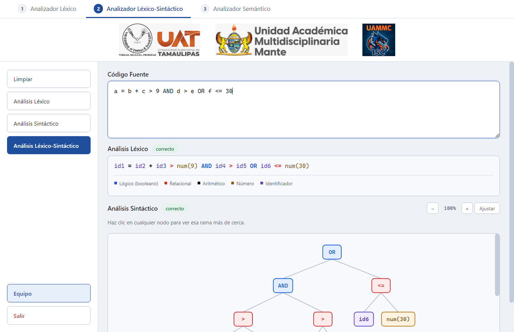

Los colores son los mismos que en el análisis léxico. La leyenda va al pie del
cuadro.

| Color | Significado |
|---|---|
| Azul | Lógico (booleano) |
| Rojo | Relacional |
| Negro | Aritmético (incluye el `=`) |
| Morado | Identificador |
| Ámbar | Valor (`num(…)`, texto, carácter) |
| Verde | Control de flujo (`si`, `para`, `mientras`…) |
| Rosa | Instrucción (`imprimirLn`, `leer`…) |

Al pasar el mouse sobre un nodo se ve su tipo y su posición en el código.

### Ver una rama de cerca

Ésta es la forma más cómoda de leer un árbol grande: **haz clic en cualquier
nodo que tenga hijos** y el cuadro se queda sólo con esa rama, ya agrandada
para llenar el ancho.

Por ejemplo, con `a = b + c > 9 AND d > e OR f <= 30` el árbol completo sale
así, con el `OR` hasta arriba:

```
                        OR
                 ┌──────┴──────┐
                AND            <=
            ┌────┴────┐      ┌──┴──┐
            >         >     id6  num(30)
```

Al hacer clic en el `AND` desaparece todo lo demás y esa rama se ve en grande,
con sus propios hijos. Arriba del cuadro aparece el camino recorrido:

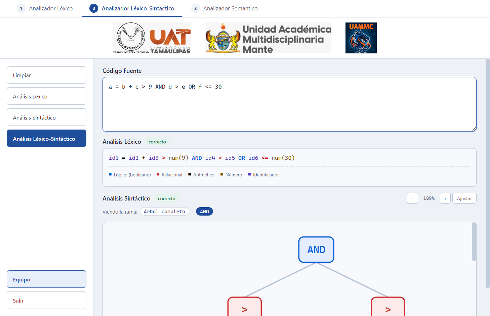

Cada paso del camino es un botón:

- **Árbol completo** regresa a la vista de todo el árbol.
- Los pasos intermedios regresan a esa altura.
- El último paso, el azul, es la rama que se está viendo.

Se puede seguir bajando: dentro del `AND` haz clic en un `>` y ahora sólo se ve
ese `>` con sus hijos, todavía más grande. El camino crece con cada clic.

El cursor cambia a una lupa sobre los nodos que se pueden abrir. Los nodos sin
hijos (las variables y los números) no se abren, porque ya no hay nada debajo.

### Acercar y alejar todo el árbol

En el encabezado de *Análisis Sintáctico* hay tres controles que agrandan o
achican lo que haya en pantalla, sea el árbol completo o una rama:

| Control | Qué hace |
|---|---|
| `−` / `+` | Aleja o acerca de 10 % en 10 %, entre 10 % y 300 %, sin mover lo que está en el centro |
| **Ajustar** | Encaja el dibujo al ancho del cuadro |
| **Ctrl + rueda** | Lo mismo, sin mover lo que está bajo el mouse |

Si el dibujo no cabe, el cuadro se desplaza hacia los cuatro lados. Al
dibujar un árbol ancho (un programa completo, como el ejemplo de las
variables), la raíz queda centrada a la vista.

---

## 8. Qué se puede analizar

La aplicación acepta tres cosas, y elige sola cuál es:

### Una o varias proposiciones sueltas

Sólo en las pestañas 1 y 2, para practicar (en la pestaña 3 les falta la
clase). No necesitan punto y coma. Cada renglón es una proposición:

```swordbyte
a > b
a = b + c
a && b || c + f > d
```

Una proposición puede seguir en el renglón de abajo si todavía no termina
(`a = b +` y abajo `c`). Dos en el mismo renglón son un error.

### Un programa completo

Como en Java, el código del lenguaje va dentro de una clase, y se ejecuta
desde `clasePrincipal`:

```swordbyte
clase ejemplo {
    clasePrincipal {
        entero edad = 20;
        si (edad >= 18) {
            imprimirLn("Mayor");
        } sino {
            imprimirLn("Menor");
        }
    }
}
```

Dentro de un bloque sólo valen las **instrucciones del lenguaje** (las de la
especificación): una expresión sola con punto y coma, como `a > b;`, no es
una instrucción, igual que en Java.

### Instrucciones sueltas: falta la clase

Si escribes instrucciones sin la clase (`entero a = 5;`), el análisis
sintáctico marca el error *Falta la clase: todo el código va dentro de una
clase*. Lo mismo si empiezas con `clasePrincipal` sin la
`clase` alrededor.

No hace falta indicar qué se escribió: la aplicación lo detecta sola.

---

## 9. Cuando hay errores

Los errores aparecen dentro del cuadro que les corresponde:

- **Errores léxicos** (un símbolo raro, una cadena sin cerrar) → renglón rojo en
  la tabla de la pestaña 1 y en el cuadro *Análisis Léxico* de la pestaña 2.
- **Errores sintácticos** (falta un `;`, un `)` sin cerrar) → en el cuadro
  *Análisis Sintáctico* de la pestaña 2.
- En la pestaña 3, si hay errores léxicos o sintácticos **no se hace el
  análisis semántico**: el recuadro rojo dice por qué y repite los errores.
- Además, en los cuadros de código cada error queda **subrayado en rojo** (ver
  la sección 2).

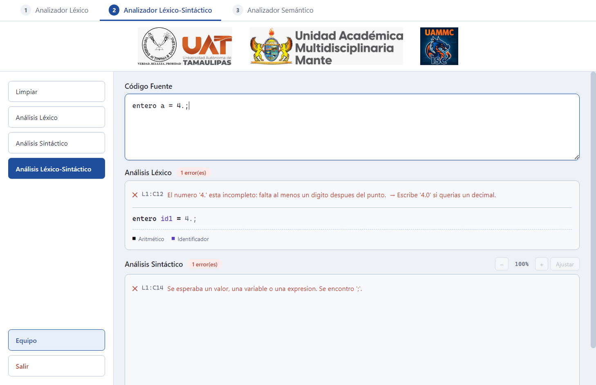

Cada error indica la línea y la columna, qué pasó y, cuando es posible, una
sugerencia de cómo arreglarlo. La insignia junto al título cambia a rojo.

---

## 10. Pestaña 3 — Analizador Semántico

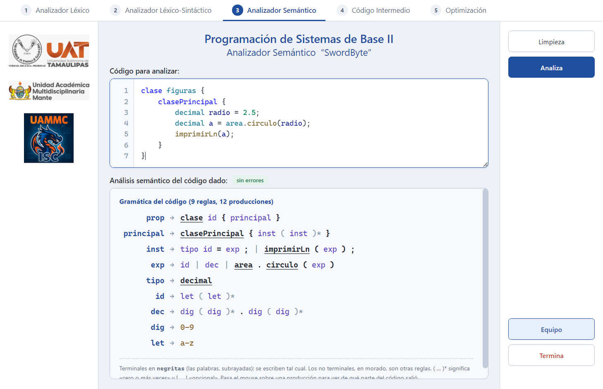

Sigue el diseño del pizarrón: los tres logos en columna a la izquierda, arriba
*Programación de Sistemas de Base II — Analizador Semántico “SwordByte”*, el
cuadro **Código para analizar**, el cuadro **Análisis semántico del código
dado** y los botones a la derecha.

| Botón | Qué hace |
|---|---|
| **Limpieza** | Vacía el código y los resultados de las seis pestañas |
| **Analiza** | Hace el análisis semántico (y llena las demás pestañas) |
| **Equipo** | Abre la ventana con los integrantes |
| **Termina** | Muestra al equipo y pregunta si quieres salir |

Las pestañas 1 y 2 revisan que el código **esté bien escrito**. La pestaña 3
revisa que **tenga sentido**:
- que cada nombre esté declarado antes de usarse;
- que los tipos coincidan (un texto no cabe en un `entero`);
- que una `Constante` no cambie;
- que las medidas de una figura sean positivas y que un triángulo tenga lados
  posibles…

**Escribe un programa SwordByte** (`clase nombre { clasePrincipal { ... } }`) y
presiona **Analiza**. El cuadro muestra:

1. **Los errores semánticos**, si hay: cada uno con su línea y columna, el
   mensaje y una sugerencia. Si no hay errores, no sale ningún recuadro: la
   insignia junto al título dice *sin errores*.
2. **Las advertencias**, en ámbar: cosas que no impiden ejecutar el programa
   pero parecen un descuido (una variable que nunca se usa, código después de
   `romper`, una división entre cero).
3. **La gramática del código**, como en el pizarrón.

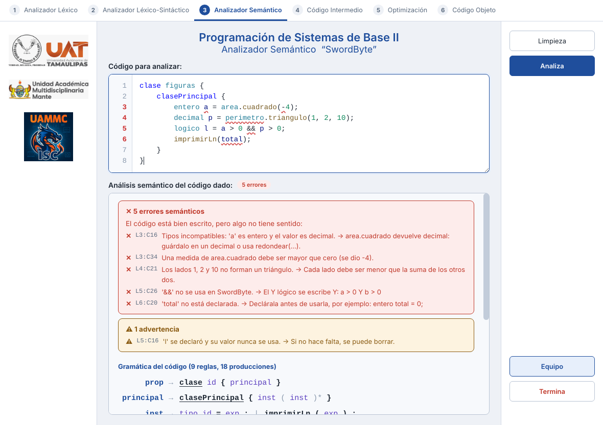

En la imagen, el código está bien escrito (la pestaña 2 dice *correcto*), pero
tiene cinco errores:
- `area.cuadrado` devuelve un decimal que no cabe en un `entero`;
- una medida es negativa;
- los lados 1, 2 y 10 no forman un triángulo;
- se usó `&&` en lugar de `Y`;
- `total` nunca se declaró.

### En el lenguaje: Y, O, NO y potencia

Las pestañas 1 y 2 reconocen varias formas de escribir lo mismo, para
practicar. En el lenguaje sólo valen:

| Para | Se escribe | En la pestaña 3 es error |
|---|---|---|
| Y · O · negación | `Y` · `O` · `NO` | `&&` `AND` · `\|\|` `OR` · `!` `NOT` |
| Potencias y raíces | `potencia(base, exponente)` | `^` `**` `√` `raiz` `raizCuadrada` `raizCubica` |

Una raíz es una potencia: `potencia(16, 0.5)` es la raíz cuadrada de 16 y
`potencia(27, 1.0 / 3)` la cúbica de 27. El error dice qué escribir en su
lugar.

### Sólo programas: falta la clase

Como en Java, el código va dentro de una clase. Las expresiones sueltas
(`a = b + c`, sin punto y coma) se practican en las pestañas 1 y 2; en la
pestaña 3 la insignia dice *falta la clase* y se muestra cómo se escribe un
programa:

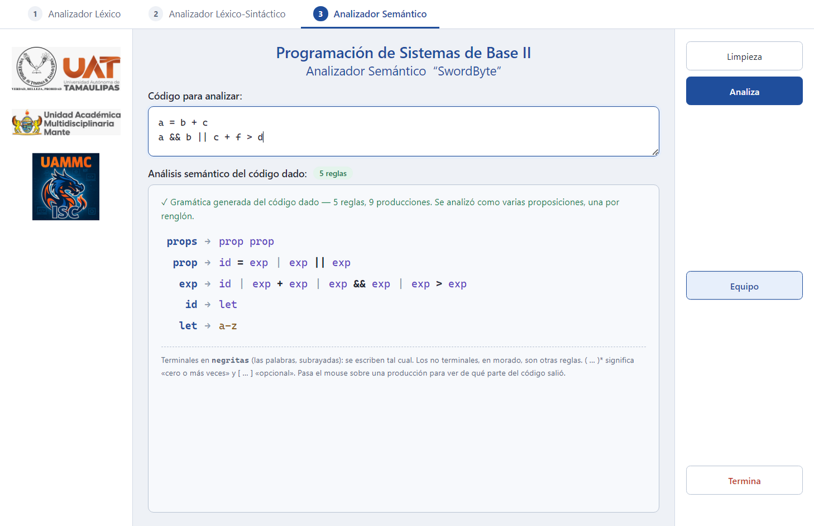

Si el código tiene errores léxicos o sintácticos (por ejemplo, instrucciones
sin la clase), la insignia dice *corrige primero* y se listan esos errores: el
sentido se revisa cuando el código ya está bien escrito.

### La gramática

Para el ejemplo del pizarrón dentro de su clase,
`clase p { clasePrincipal { a1 = b5 / 20; } }`, la gramática es:

```
prop      → clase id { principal }
principal → clasePrincipal { inst }
inst      → id = exp ;
exp       → id | num | exp / exp
id        → let ( dig )*
num       → dig ( dig )*
dig       → 0-9
let       → a-z
```

Como `a1` y `b5` no están declaradas, también salen dos errores. Aun así la
gramática sale igual: describe la forma del código, y la forma es correcta.

Cómo leerla:

- **`prop`** es la proposición: todo el programa. Cada instrucción es una
  alternativa de `inst`. Las demás reglas salen de arriba hacia abajo y al
  final van las de los caracteres (`dig`, `LET`, `let`, `simb`).
- Sólo salen las alternativas que **aparecen en tu código**: si no hay
  multiplicaciones, no sale `exp → exp * exp`.
- Los **terminales** (lo que se escribe tal cual) van en negritas; las
  palabras, además, **subrayadas**, como en el pizarrón. Los **no terminales**
  (otras reglas) van en morado.
- `( … )*` quiere decir «cero o más veces» y `[ … ]` «opcional».
- **Pasa el mouse** sobre una producción para ver de qué parte del código salió.

Todas las reglas que revisa, con un ejemplo de cada mensaje, están en
[08 — Analizador semántico](08-analizador-semantico.md).

---

## 10 bis. Pestaña 4 — Generador de Código Intermedio

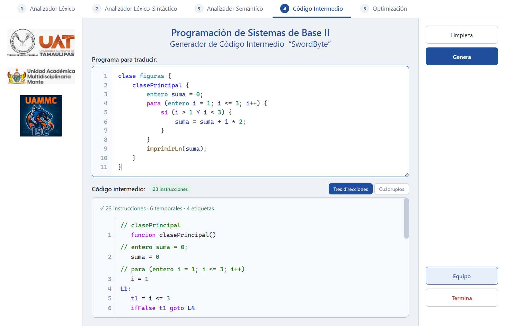

Tiene el estilo de la pestaña 3: los tres logos en columna a la izquierda,
arriba *Programación de Sistemas de Base II — Generador de Código Intermedio
“SwordByte”*, el cuadro **Programa para traducir**, el cuadro **Código
intermedio** y los botones a la derecha.

| Botón | Qué hace |
|---|---|
| **Limpieza** | Vacía el código y los resultados de las seis pestañas |
| **Genera** | Genera el código intermedio (y llena las demás pestañas) |
| **Equipo** | Abre la ventana con los integrantes |
| **Termina** | Muestra al equipo y pregunta si quieres salir |

Escribe un programa **sin errores** y presiona **Genera**. Se traduce a
**código de tres direcciones**: cada instrucción hace una sola operación.

```
entero a = b + c * d;          t1 = c * d
                               t2 = b + t1
                               a = t2
```

- `t1`, `t2`… son **temporales**: guardan los resultados a medio camino.
- `L1`, `L2`… son **etiquetas**: a donde saltan las decisiones y los ciclos
  (`goto L1`, `ifFalse t1 goto L2`).
- En verde, antes de cada grupo, el renglón del programa de donde sale.

Con los botones junto al título cambias de vista:

| Vista | Qué muestra |
|---|---|
| **Tres direcciones** | El código intermedio, una instrucción por renglón, con su número |
| **Cuádruplos** | La misma lista como tabla: operador, argumento 1, argumento 2 y resultado |

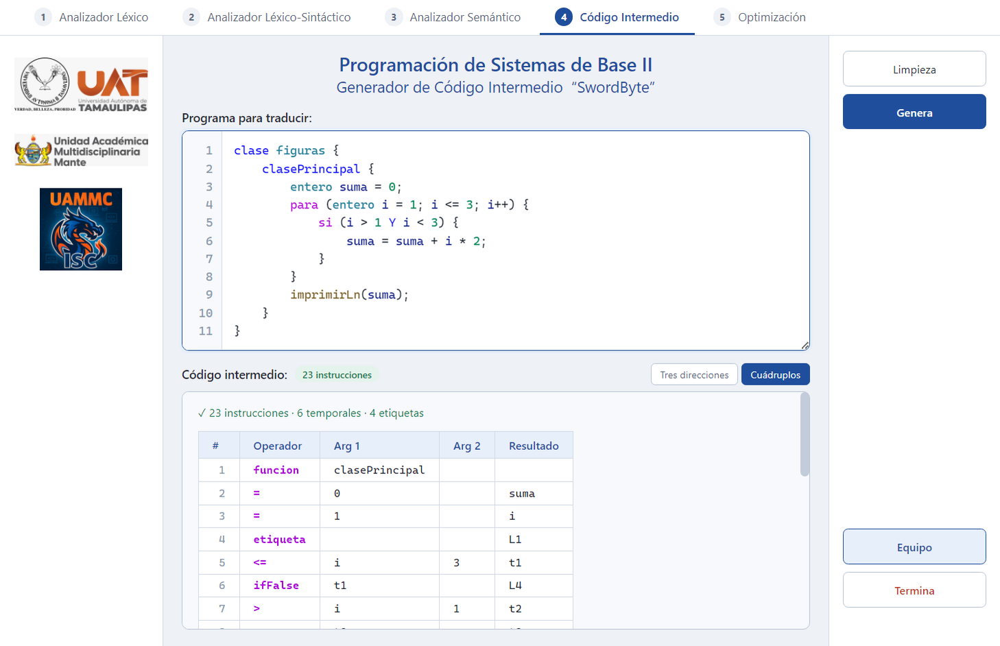

Si el programa tiene algún error (léxico, sintáctico o semántico), la insignia
dice *corrige primero* y se listan los errores: el código intermedio sólo se
genera para un programa correcto. Cómo se traduce cada instrucción está en
[09 — Código intermedio](09-codigo-intermedio.md).

---

## 10 ter. Pestaña 5 — Optimizador de Código Intermedio

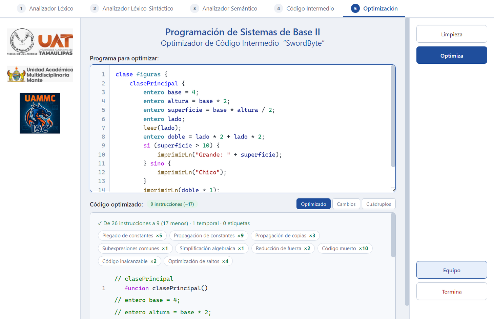

Mismo estilo que las pestañas 3 y 4: arriba *Programación de Sistemas de Base
II — Optimizador de Código Intermedio “SwordByte”*, el cuadro **Programa para
optimizar**, el cuadro **Código optimizado** y los botones a la derecha.

| Botón | Qué hace |
|---|---|
| **Limpieza** | Vacía el código y los resultados de las seis pestañas |
| **Optimiza** | Optimiza el código intermedio (y llena las demás pestañas) |
| **Equipo** | Abre la ventana con los integrantes |
| **Termina** | Muestra al equipo y pregunta si quieres salir |

Escribe un programa sin errores y presiona **Optimiza**. Se toma el código de
tres direcciones de la pestaña 4 y se mejora **sin cambiar lo que hace el
programa**: se calcula desde ahora lo que ya se sabe (`2 * 3` → `6`), no se
calcula dos veces lo mismo y se quita lo que sobra.

```
entero b = 2;              Pestaña 4                Pestaña 5
entero a = b * 3;          b = 2                    param 6
imprimirLn(a);             t1 = b * 3               call imprimirLn, 1
                           a = t1
                           param a
                           call imprimirLn, 1
```

Arriba del resultado, un **resumen**: de cuántas instrucciones a cuántas, y una
ficha por cada optimización con cuántas veces se usó. Al pasar el mouse sobre
una ficha se ve qué hace.

| Vista | Qué muestra |
|---|---|
| **Optimizado** | El código que quedó. Las instrucciones que cambiaron van en verde, con lo que se les hizo a la derecha. Al pasar el mouse se ve de qué renglón sale y qué número tenía en la pestaña 4 |
| **Cambios** | Cada cambio en el orden en que se hizo: la optimización, el *antes*, el *después* y el renglón del programa |
| **Cuádruplos** | La tabla del código optimizado |

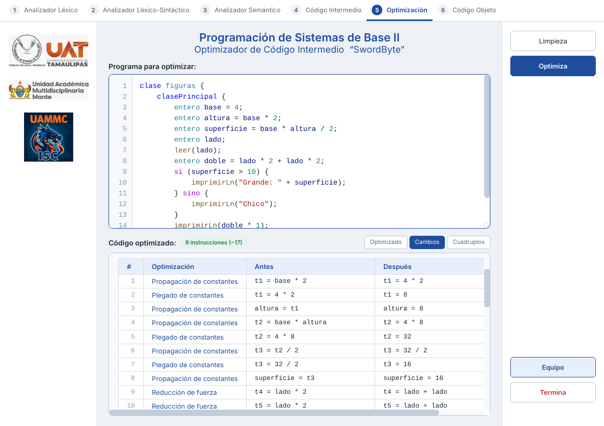

Cada optimización y lo que no se optimiza a propósito (por ejemplo, `10 / 0`
se deja, porque debe fallar al ejecutarse) están en
[10 — Optimización](10-optimizacion.md).

---

## 10 cuater. Pestaña 6 — Generador de Código Objeto (Java)

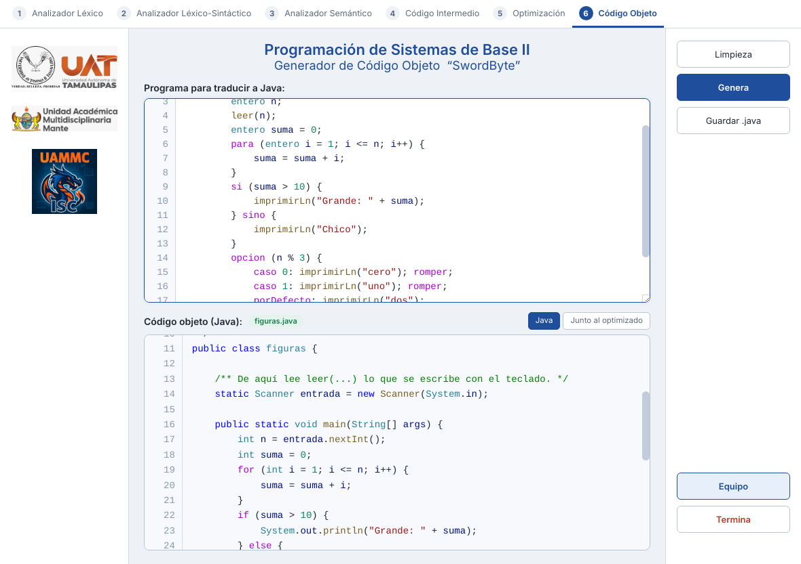

Mismo estilo: arriba *Programación de Sistemas de Base II — Generador de Código
Objeto “SwordByte”*, el cuadro **Programa para traducir a Java**, el cuadro
**Código objeto (Java)** y los botones a la derecha.

| Botón | Qué hace |
|---|---|
| **Limpieza** | Vacía el código y los resultados de las seis pestañas |
| **Genera** | Escribe el programa en Java (y llena las demás pestañas) |
| **Guardar .java** | Guarda el programa Java (ver abajo) |
| **Equipo** | Abre la ventana con los integrantes |
| **Termina** | Muestra al equipo y pregunta si quieres salir |

Escribe un programa sin errores y presiona **Genera**. El código optimizado de
la pestaña 5 se escribe en **Java**, el lenguaje destino de SwordByte: los
saltos (`goto`, `ifFalse … goto`) se vuelven `if`, `while`, `for` y `switch`,
y las instrucciones de tres direcciones se juntan otra vez en expresiones.

Arriba, un resumen: el archivo (`figuras.java`), cuántos renglones y métodos
tiene, y las **funciones de apoyo** que lleva (lo que SwordByte tiene y Java no
trae tal cual, como `aleatorio` o `esperar`).

| Vista | Qué muestra |
|---|---|
| **Java** | El programa, con sus números de renglón y los colores de Java. Al pasar el mouse sobre un renglón se ve de qué línea del programa SwordByte sale |
| **Junto al optimizado** | A la izquierda el código de tres direcciones optimizado y a la derecha el Java, para compararlos |

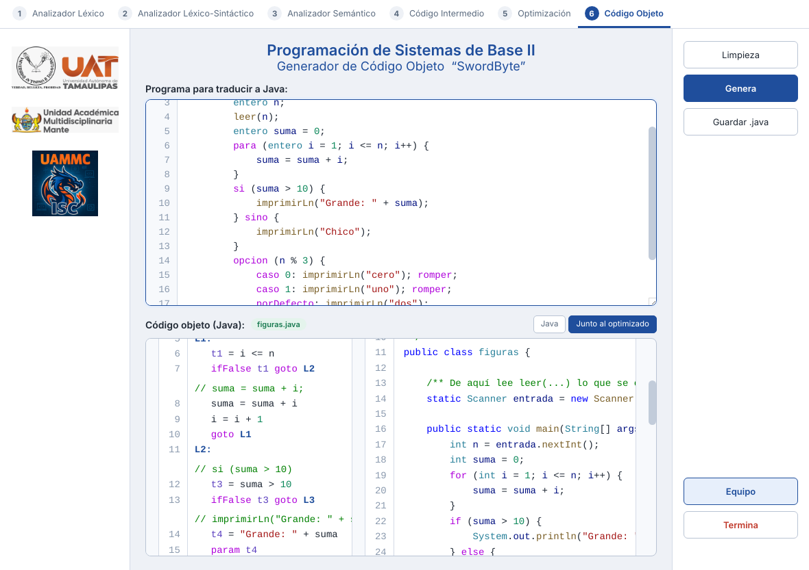

### Guardar y ejecutar el Java

**Guardar .java**, **Archivo → Guardar código Java** o `Ctrl+J` guardan el
programa. Java exige que el archivo se llame igual que la clase
(`public class figuras` → `figuras.java`), así que el diálogo propone ese
nombre; si escribes otro, la aplicación avisa y lo guarda con el de la clase.

Luego, en una terminal, en la carpeta donde lo guardaste (hace falta tener el
JDK de Java instalado):

```bash
javac -encoding UTF-8 figuras.java
java figuras
```

Cómo se traduce cada cosa está en [11 — Código objeto](11-codigo-objeto.md).

---

## 11. La ventana del equipo y la ventana de salida

El botón **Equipo** (pestañas 2 a 6) abre una ventana con el nombre del equipo
y los integrantes en orden alfabético por apellidos.

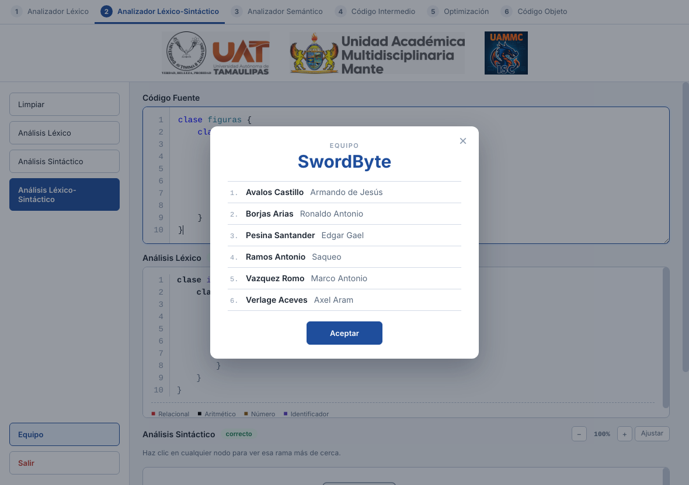

Se cierra con el botón *Aceptar*, con la **×**, con la tecla **Esc** o haciendo
clic fuera de ella.

Los botones **Fuga** (pestaña 1), **Salir** (pestaña 2), **Termina** (pestañas 3
a 6) y **Archivo → Salir** (`Ctrl+Q`) abren la **ventana de salida**: muestra al
equipo y pregunta *¿Quieres salir del compilador?*

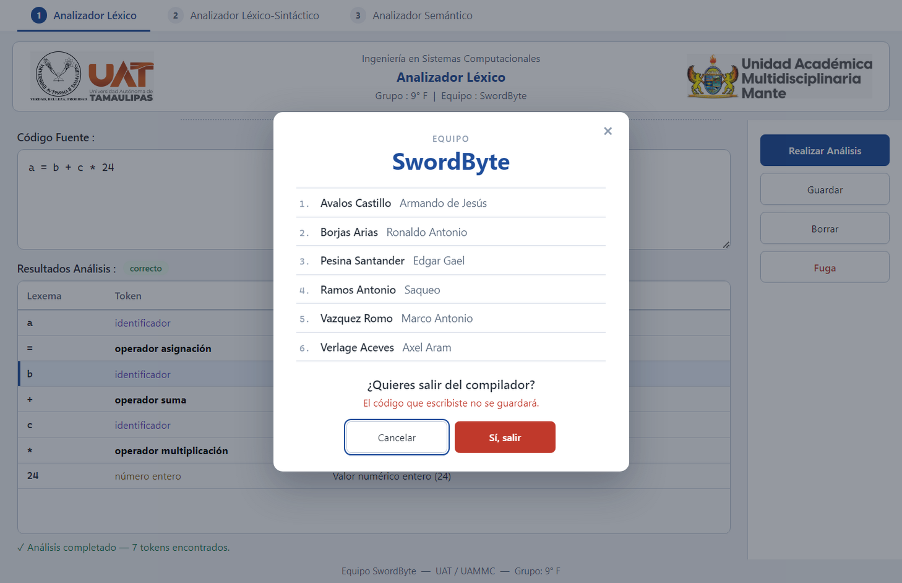

| Opción | Qué pasa |
|---|---|
| **Sí, salir** | Se cierra la aplicación |
| **Cancelar**, **×**, `Esc` o clic afuera | Se cierra la ventana y sigues trabajando |

Si hay código escrito, avisa en rojo que no se va a guardar. El botón que queda
seleccionado es *Cancelar*, para que un `Enter` sin pensar no cierre la
aplicación.

---

## 12. Guardar y volver a abrir

**Archivo → Guardar reporte** (`Ctrl+S`) o el botón **Guardar** de la pestaña 1
guardan un **reporte completo** del código.

**El archivo se llama igual que la clase**, como en Java: si tu programa es
`clase ejemplo { ... }`, el diálogo propone `ejemplo.html`. Si escribes otro
nombre, la aplicación te avisa y lo guarda con el nombre de la clase. (Si el
código no tiene clase, se llama `analisis`.)

El diálogo ofrece dos formatos:

| Formato | Cómo se ve | Para qué |
|---|---|---|
| **Reporte visual** (`.html`, el que sale primero) | Una página web con colores, la tabla de tokens, el árbol dibujado, el análisis semántico, el código intermedio, el optimizado y el Java | Revisarlo, entregarlo, imprimirlo o pasarlo a PDF |
| **Reporte en texto** (`.bs`) | Texto con comentarios `//` | Quien prefiera un archivo de texto |

Los dos se pueden **volver a abrir en el compilador**.

### El reporte visual

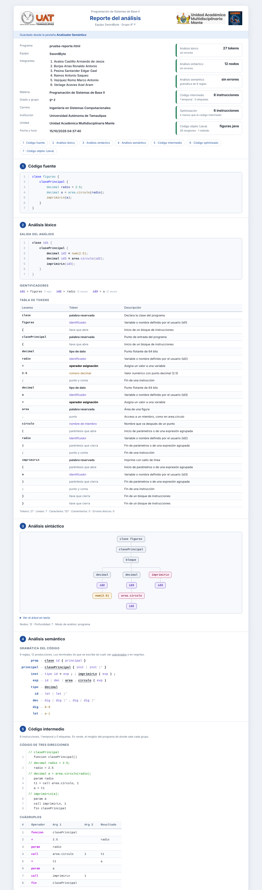

Se abre con **doble clic** en cualquier navegador (Edge, Chrome, Firefox) y
trae:

- **El encabezado**: los logos, la materia, el equipo y el grupo, de qué pestaña
  se guardó, y una ficha con el programa, los seis integrantes, la carrera, la
  institución, la unidad y la fecha y hora. A la derecha, un resumen de las
  seis fases.
- **1. Código fuente**, con los renglones numerados.
- **2. Análisis léxico**: la salida `id1 > id2` en colores, la lista de
  identificadores y la tabla de tokens.
- **3. Análisis sintáctico**: el árbol dibujado (y, al desplegar *Ver el árbol
  en texto*, la versión con sangría), o los errores.
- **4. Análisis semántico**: los errores y las advertencias, si hay, y la
  gramática generada del código, con los terminales subrayados como en la
  pestaña 3.
- **5. Código intermedio**: el código de tres direcciones y los cuádruplos.
- **6. Código optimizado**: el código que quedó y la lista de cambios.
- **7. Código objeto (Java)**: el programa en Java, con sus colores.

Al terminar de guardar aparece un aviso con el botón **Abrir reporte**, que lo
abre en el navegador.

Es **un solo archivo**: los logos y los colores van adentro, así que se puede
mandar por correo o copiar a una USB sin que se rompa. Para imprimirlo o
guardarlo como PDF: `Ctrl+P` en el navegador.

### Volver a usarlo en el compilador

Hay dos formas:

1. **Archivo → Abrir** (`Ctrl+O`) y elegir el `.html`.
2. **Arrastrar** el `.html` desde el explorador de archivos y soltarlo sobre la
   ventana del compilador.

El código regresa a las seis pestañas, la aplicación **cambia a la pestaña desde
la que se guardó** y lo analiza de nuevo.

Esto funciona porque el reporte guarda, escondido, un bloque con el código tal
cual. El navegador no lo muestra; el compilador lo lee al abrirlo. Por eso sólo
se pueden abrir los reportes hechos por esta aplicación: una página web
cualquiera no trae ese bloque.

### El reporte en texto

Si en el diálogo eliges **Reporte en texto (`.bs`)**, se guarda el reporte de
siempre: todo lo que no es código va en comentarios `//`, así que el archivo
**sigue siendo un programa SwordByte válido** y se lee en el Bloc de notas.

```
// ==========================================================================
//  C O M P I L A D O R   S W O R D B Y T E
//  Reporte de las seis fases: del código SwordByte al código Java
// ==========================================================================
//  Programa .......... analisis.bs
//  Equipo ............ SwordByte
//  ...
// --------------------------------------------------------------------------
//  1. CÓDIGO FUENTE
// --------------------------------------------------------------------------
// >>>>> INICIO DEL CODIGO FUENTE
a = b + c > 9 AND d > e OR f <= 30
// <<<<< FIN DEL CODIGO FUENTE
//  ...
//  2. ANÁLISIS LÉXICO       (la salida id1 > id2 y los identificadores)
//  3. ANÁLISIS SINTÁCTICO   (el árbol con sangría:  OR  ├── AND ...)
//  4. ANÁLISIS SEMÁNTICO    (errores, advertencias y gramática)
//  5. CÓDIGO INTERMEDIO     (el código de tres direcciones, comentado)
//  6. CÓDIGO INTERMEDIO OPTIMIZADO  (el código que quedó y cada cambio)
//  7. CÓDIGO OBJETO (JAVA)  (el programa en Java, comentado)
```

Al abrirlo se recupera sólo el código, usando las marcas
`INICIO`/`FIN DEL CODIGO FUENTE`, así que guardar dos veces **no anida**
reportes.

### Cambiar los datos del encabezado

Están en [`src/core/comun/Equipo.js`](../src/core/comun/Equipo.js): el nombre
del equipo, los integrantes, la materia, el grado y el grupo. Los usan el
encabezados de las pestañas, las ventanas del equipo y de salida, y los dos
reportes.

Si quieres que aparezca **un solo autor** en vez de los seis en el reporte en
texto, escribe su nombre en la constante `AUTOR` de ese mismo archivo.

---

## 13. Menú y atajos de teclado

### El menú

| Menú | Contiene |
|---|---|
| **Archivo** | Abrir, Guardar reporte, Guardar código Java, Limpiar, Salir |
| **Analizar** | Analizar (llena las seis pestañas) |
| **Ejemplos** | Los programas incluidos; al elegir uno se carga y se analiza |
| **Ver** | Las seis pestañas, recargar, herramientas de desarrollo, zoom, pantalla completa |
| **Ayuda** | Equipo, Documentación del proyecto, Acerca de |

### Atajos

| Atajo | Acción |
|---|---|
| `Ctrl+1` … `Ctrl+6` | Ir a la pestaña 1 a 6 |
| `Ctrl+Tab` / `Ctrl+Shift+Tab` | Pestaña siguiente / anterior |
| `F5` | Analizar (llena las seis pestañas) |
| `Ctrl+O` | Abrir un reporte `.html`, un `.bs` o un `.txt` |
| `Ctrl+S` | Guardar reporte |
| `Ctrl+J` | Guardar el código Java (`.java`) |
| `Ctrl+L` | Limpiar |
| `Ctrl+Q` | Salir (pregunta antes) |
| `Tab` | Inserta 4 espacios en el cuadro de código |
| `Esc` | Cierra la ventana del equipo o la de salida |
| `Ctrl` + rueda / `Ctrl +` / `Ctrl -` | Zoom de la aplicación |
| `F11` | Pantalla completa |

---

## 14. Cambiar los logos

Los logos viven en `src/ui/img/`:

```
logo-uat.jpeg      logo-uamm.jpeg      logo-isc.jpeg
```

Para cambiar alguno, copia ahí la imagen nueva **con el mismo nombre**. No hay
que tocar código.

Cada logo se escala para caber en el encabezado sin deformarse, así que sirven
tanto los logos apaisados como los cuadrados: no hace falta recortarlos.

Si no encuentra la imagen, muestra las siglas en su lugar.

Después de cambiar un logo hay que volver a generar el ejecutable
(`npm run dist`) para que lo traiga incluido.

---

## 15. Problemas frecuentes

| Problema | Solución |
|---|---|
| Al ejecutar `npm start` se abre una consola de Node en vez de la ventana | La variable `ELECTRON_RUN_AS_NODE` está activa en esa terminal. Abre una terminal normal, o ejecútalo con `set ELECTRON_RUN_AS_NODE=` antes. |
| `npm run dist` falla con *Cannot create symbolic link* | Windows pide permisos para crear enlaces simbólicos. Activa el Modo de desarrollador de Windows, o ejecuta la terminal como administrador. Ver [07-mantenimiento.md](07-mantenimiento.md#empaquetado). |
| Los logos salen como siglas en un recuadro | No encontró ningún archivo de imagen. Revisa los nombres en `src/ui/img/`. |
| *Ayuda → Documentación del proyecto* no abre nada | La carpeta `docs/` viaja junto al ejecutable (`resources/docs`). Si falta, la aplicación lo avisa y dice dónde la buscó. En el proyecto está en `docs/`. |
| El antivirus marca el `.exe` | Es normal en ejecutables sin firma digital. El instalador y el portable se generan localmente desde este código. |
| El árbol se sale del cuadro | El cuadro se desplaza. También puedes alejar con `Ctrl -`. |
| Al abrir un `.html` dice que *no es un reporte del compilador* | Sólo se pueden abrir los reportes que guardó esta aplicación: son los que traen el código guardado adentro. Una página web cualquiera no lo trae. |
| El reporte `.html` se ve sin colores en el Bloc de notas | Es una página web: se abre con doble clic (se abre en el navegador). Para volver a usarlo en el compilador, ábrelo con `Ctrl+O` o arrástralo a la ventana. |
| Marca *'break' no es una palabra de SwordByte* (o `int`, `if`, `System`…) | El lenguaje está basado en Java pero usa sus propias palabras. La sugerencia del error dice cuál va: `romper`, `entero`, `si`, `imprimirLn`… |
| Marca *'a > b' no es una instrucción del lenguaje* | Con punto y coma sólo valen las instrucciones del lenguaje. Guarda el resultado (`x = a > b;`), úsalo en una condición (`si (a > b) { … }`) o quítale el `;` para analizarla suelta. |
| Marca *Falta la clase* | Como en Java, el código va dentro de una clase: `clase ejemplo { clasePrincipal { ... } }`. Sólo las expresiones sueltas (sin `;`) se aceptan sin clase, en las pestañas 1 y 2. |
| Marca *'&&' no se usa en SwordByte* (o `^`, `√`, `raiz`…) en la pestaña 3 | En el lenguaje la lógica es `Y`, `O`, `NO` y las potencias y raíces se sacan con `potencia(base, exponente)`. La sugerencia dice cómo escribirlo. |
| Al guardar, el archivo se llama distinto de lo que escribí | Como en Java, el archivo se llama igual que la clase (`clase ejemplo` → `ejemplo.html`, `ejemplo.java`). Para otro nombre, cambia el de la clase. |
| `javac` no se encuentra | Hace falta el JDK de Java (versión 11 o más nueva) y que su carpeta `bin` esté en el `PATH`. Se comprueba con `javac -version`. |
| `javac` marca *class figuras is public, should be declared in a file named figuras.java* | El archivo debe llamarse igual que la clase: guárdalo con **Guardar .java**, que pone el nombre correcto. |
| El Java imprime acentos raros | Compílalo con `javac -encoding UTF-8`. En la consola de Windows puede hacer falta `chcp 65001`. |
