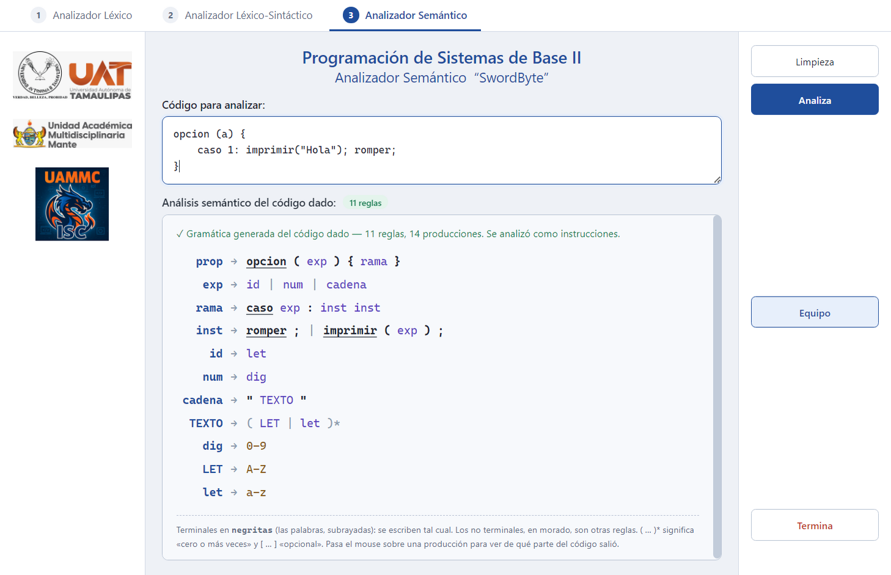

# Pestaña 3 — Analizador semántico: la gramática del código

Le das **cualquier código del lenguaje SwordByte** y el analizador **genera su
gramática**: las reglas que producen exactamente ese código. Sirve con:

- una proposición suelta: `a = b + c`, `a && b || c + f > d`, `a`;
- varias proposiciones, una por renglón o cada una con su `;`;
- las instrucciones del lenguaje (`entero a = 5;`, `si`, `para`, `opcion`…);
- un programa completo (`clase p { clasePrincipal { … } }`).


Es lo mismo que se hizo en el pizarrón. Para el código `a1 = b5 / 20` el
pizarrón dice:

```
prop → id = exp
exp  → id | num | exp / exp
id   → let ( let | dig | _ )*
num  → dig dig*
dig  → 0-9
let  → a-z
```

y el analizador genera:

```
prop → id = exp
exp  → id | num | exp / exp
id   → let ( dig )*
num  → dig ( dig )*
dig  → 0-9
let  → a-z
```

La única diferencia está en `id`: el analizador escribe sólo los caracteres que
de verdad aparecen en los nombres (`a1` y `b5` llevan letra y luego dígitos,
nunca `_`). Ver la sección 3.

El código vive en
[`src/core/semantico/AnalizadorSemantico.js`](../src/core/semantico/AnalizadorSemantico.js).

---

## 1. El mismo lenguaje y las mismas reglas que las otras pestañas

El analizador semántico **no tiene un lenguaje propio**. Trabaja sobre lo que ya
hicieron las otras dos pestañas:

```
  Código
    │
    ▼
  Analizador léxico       (pestaña 1)  ── tokens
    │
    ▼
  Analizador sintáctico   (pestaña 2)  ── árbol (AST)
    │
    ▼
  Analizador semántico    (pestaña 3)  ── recorre el árbol y escribe su gramática
```

Por eso acepta todo lo que acepta la pestaña 2 y nada más. Si el código tiene
un error léxico o sintáctico, no hay árbol confiable y **no se genera la
gramática**: la pestaña muestra los errores para corregirlos primero.

> Lo que viene en los recuadros del pizarrón (`switch a case 1:
> printf("Hola"); break;`) es sólo un ejemplo de otro lenguaje. En SwordByte
> eso se escribe `opcion (a) { caso 1: imprimir("Hola"); romper; }`, y su
> gramática generada es la de la captura de la sección 4.

---

## 2. Cómo se genera

### Paso 1 — Cada nodo del árbol aporta una producción

Se recorre el árbol de arriba hacia abajo. Cada nodo dice **cómo se escribió**,
poniendo un no terminal en lugar de cada parte que es otra cosa:

| En el código | Nodo del árbol | Producción que aporta |
|---|---|---|
| `b5 / 20` | división | `exp → exp / exp` |
| `b5` | variable | `exp → id` |
| `20` | número | `exp → num` |
| `(a + b)` | expresión entre paréntesis | `exp → ( exp )` |
| `entero a = 5;` | declaración | `inst → tipo id = exp ;` |
| `si (a > b) { romper; }` | si | `inst → si ( exp ) { inst }` |
| `caso 1: romper;` | caso de opcion | `rama → caso exp : inst` |

La raíz es `prop`, la proposición. Si el código es una sola expresión o una
sola instrucción, `prop` es su forma (`prop → id = exp`). Si es un programa
completo, `prop → clase id { … }`. Si son **varias proposiciones**, ver la
sección 2 bis.

Sólo salen las alternativas que **aparecen en el código**: si no hay
multiplicaciones, no sale `exp → exp * exp`. Las repetidas se escriben una sola
vez.

### Paso 2 — Las listas

Cuando una parte es una lista (argumentos, instrucciones de un bloque,
casos…), se escribe así:

| Elementos | Se escribe | Ejemplo |
|---|---|---|
| 1 | `X` | `{ inst }` |
| 2 | `X X` o `X , X` | `( exp , exp )` |
| 3 o más, iguales | `X ( , X )*` | `( exp ( , exp )* )` |
| 3 o más, distintos | uno tras otro | `id = exp , id` |

### Paso 3 — Las palabras y los caracteres

Al final se escriben las reglas de las palabras que aparecieron, **sólo con los
caracteres que se usaron**:

| Regla | Cuándo sale | Cómo se escribe |
|---|---|---|
| `tipo` | hay declaraciones | `tipo → entero \| cadena` (los usados) |
| `id` | hay nombres | `id → inicio ( resto )*` (ver la sección 3) |
| `num` | hay enteros | `num → dig` si todos son de un dígito; si no, `num → dig ( dig )*` |
| `dec` | hay decimales | `dec → dig ( dig )* . dig ( dig )*` |
| `cadena` | hay textos | `cadena → " TEXTO "` |
| `TEXTO` | hay textos | `TEXTO → ( LET \| let \| dig \| simb )*` con las clases usadas |
| `car` | hay caracteres | `car → ' LET '` |
| `logico` | hay `verdadero` / `falso` | `logico → verdadero` |
| `dig` · `LET` · `let` | se usaron dígitos, mayúsculas o minúsculas | `dig → 0-9` · `LET → A-Z` · `let → a-z` |
| `simb` | un texto lleva símbolos | `simb → ␣ \| !` (los usados; `␣` es el espacio) |

La `ñ` y las letras con acento cuentan como letras, igual que en el analizador
léxico: si el código dice `año`, sale `let → a-z | ñ`.

---

## 2 bis. Varias proposiciones

Con varias proposiciones, una por renglón:

```
a = b + c
a && b || c + f > d
```

la gramática empieza con una regla más, `props`, que dice que el código es
una proposición tras otra; cada proposición aporta su forma como alternativa
de `prop`:

```
props → prop prop
prop  → id = exp | exp || exp
exp   → id | exp + exp | exp && exp | exp > exp
id    → let
let   → a-z
```


Lo mismo pasa con instrucciones con punto y coma (`a = 1; x > y;` da
`prop → id = exp ; | exp > exp ;`). Con tres o más proposiciones, `props`
se escribe con repetición: `props → prop ( prop )*`.

Fíjate en el orden en que se agrupa `a && b || c + f > d`: por la jerarquía del
lenguaje, `||` queda hasta arriba, así que `prop → exp || exp`; adentro, `&&`
une a `a` y `b`, y `>` compara `c + f` con `d`.

---

## 3. El caso del identificador

El analizador léxico acepta nombres que empiezan con letra o `_` y siguen con
letras, dígitos o `_`. En vez de copiar siempre esa regla completa, el
analizador escribe **sólo lo que se usó**:

| Nombres en el código | Regla generada |
|---|---|
| `a`, `b` | `id → let` |
| `a1`, `b5` | `id → let ( dig )*` |
| `edad`, `nombre` | `id → let ( let )*` |
| `miVariable2` | `id → let ( let \| LET \| dig )*` |
| `_x` | `id → _ ( let )*` |

Así, la gramática describe exactamente el código dado, igual que el `var → let`
del pizarrón para una variable de una sola letra.

---

## 4. Qué se ve en la pestaña



Sigue el diseño del pizarrón: los logos en columna a la izquierda, el título
*Programación de Sistemas de Base II — Analizador Semántico “SwordByte”*, el
cuadro **Código para analizar**, el cuadro **Análisis semántico del código
dado** y, a la derecha, **Limpieza**, **Analiza**, **Equipo** y **Termina**.

En el cuadro del análisis:

- Una línea verde con cuántas reglas y producciones salieron, y cómo se leyó el
  código (expresión, instrucciones o programa completo).
- La gramática, una regla por renglón: `regla → alternativa | alternativa`.
  - Los **terminales** (lo que se escribe tal cual) van en negritas; las
    palabras, además, **subrayadas**, como en el pizarrón.
  - Los **no terminales** (otras reglas) van en morado.
  - La notación `( … )*` (cero o más veces), `[ … ]` (opcional) y `|` va en gris.
- **Al pasar el mouse** sobre una alternativa se ve de qué parte del código
  salió: sobre `exp / exp` dice *En el código: b5 / 20*.

Si el código tiene errores, el cuadro dice *No se pudo generar la gramática* y
lista los errores con su línea y columna.

---

## 5. Lo que devuelve

`compilar(fuente).semantico` trae:

```js
{
  vacio: false,              // true si no había código
  correcto: true,            // true si se generó la gramática
  errores: [],               // los errores léxicos y sintácticos que lo impidieron
  modo: 'expresion',         // 'expresion' | 'proposiciones' | 'instrucciones' | 'programa'
  totalAlternativas: 8,
  reglas: [
    {
      regla: 'exp',
      descripcion: 'Una expresión',
      alternativas: [
        { texto: 'id', ejemplo: 'b5', simbolos: [{ texto: 'id', clase: 'no-terminal' }] },
        { texto: 'num', ejemplo: '20', simbolos: [...] },
        { texto: 'exp / exp', ejemplo: 'b5 / 20', simbolos: [
            { texto: 'exp', clase: 'no-terminal' },
            { texto: '/',   clase: 'terminal' },
            { texto: 'exp', clase: 'no-terminal' }
        ] }
      ]
    },
    // ...
  ]
}
```

Cada símbolo tiene una `clase`:

| Clase | Qué es | Ejemplo |
|---|---|---|
| `no-terminal` | El nombre de otra regla | `exp`, `id`, `inst` |
| `terminal` | Se escribe tal cual en el código | `si`, `(`, `;`, `+` |
| `meta` | Notación de la gramática, no del código | `(`, `)*`, `\|`, `[`, `]` |
| `rango` | Un rango de caracteres | `0-9`, `a-z`, `A-Z` |

---

## 6. Las piezas

| Pieza | Qué hace |
|---|---|
| `analizarSemantico(sintactico, erroresLexicos)` | Punto de entrada: revisa que no haya errores y arma el resultado |
| `GeneradorGramatica.raiz()` | Decide qué es `prop` según el tipo de código, y si hace falta `props` |
| `formaInstruccion()` / `formaExpresion()` | La forma de cada nodo: un `case` por tipo de instrucción o de expresión |
| `lista()` | Junta los elementos de una lista (sección 2, paso 2) |
| `reglaId()`, `reglasNumericas()`, `reglasDeTexto()` | Las reglas de las palabras (sección 2, paso 3) |
| `ordenDeReglas()` | Pone `prop` primero, luego la estructura de arriba hacia abajo, luego las palabras y al final los caracteres |
| [`TextoDeNodo.js`](../src/core/semantico/TextoDeNodo.js) | Vuelve a escribir un nodo como código, para el *En el código: …* |

Para que la gramática pueda escribir `exp → ( exp )` y `equipo ( Null ) ;`, el
analizador sintáctico anota en el árbol dos datos que antes descartaba: si una
expresión iba entre paréntesis (`parentesis: true`) y si `equipo` llevaba
`Null` (`conNull`). No cambian el dibujo del árbol.

---

## 7. Probar sólo esta parte

```js
const { compilar } = require('./src/core/Compilador');
const { reglaATexto } = require('./src/core/semantico/AnalizadorSemantico');

compilar('a1 = b5 / 20').semantico.reglas.forEach((r) => console.log(reglaATexto(r)));
// prop → id = exp
// exp → id | num | exp / exp
// id → let ( dig )*
// num → dig ( dig )*
// dig → 0-9
// let → a-z
```

`npm run pruebas` corre el grupo *Analizador semántico: la gramática del código
(pestaña 3)*, que revisa el ejemplo del pizarrón, las proposiciones sueltas
(`a = b + c`, `a && b || c +f > d`), varias proposiciones, cada tipo de
instrucción, las listas, el orden de las reglas, los caracteres y los errores.
