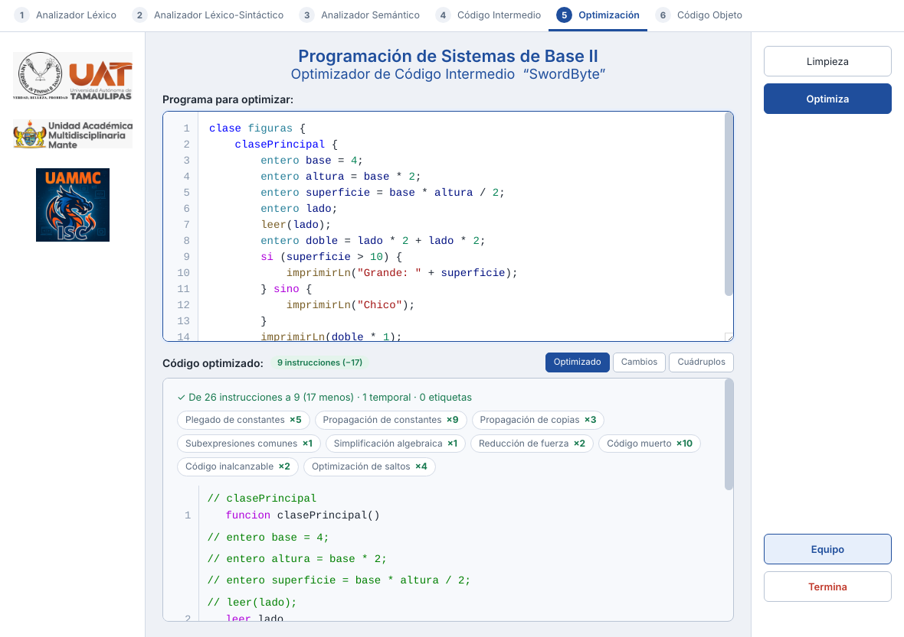

# Pestaña 5 — Optimizador de código intermedio

La fase 5 toma el código de tres direcciones de la fase 4 y lo **mejora sin
cambiar lo que hace el programa**: calcula desde ahora lo que ya se sabe, deja
de calcular dos veces lo mismo y quita las instrucciones que sobran. El
resultado sigue siendo código de tres direcciones (las mismas instrucciones,
los mismos cuádruplos), sólo que más corto.


El código vive en [`src/core/05.optimizacion/`](../src/core/05.optimizacion/).

---

## 1. Dónde va en el compilador

```
  Código ─► 1. Léxico ─► 2. Sintáctico ─► 3. Semántico ─► 4. Intermedio ─► 5. OPTIMIZACIÓN ─► 6. Código Java
```

Trabaja sólo con lo que entregó la fase 4: si el programa tiene errores (de
cualquier fase), la pestaña pide corregirlos primero. Lo que sale de aquí es
lo que traduce a Java la fase 6.

Un ejemplo completo:

```
entero b = 2;                     Fase 4 (7 instrucciones)     Fase 5 (2 instrucciones)
entero a = b * 3;                 b = 2                        param 6
imprimirLn(a);                    t1 = b * 3                   call imprimirLn, 1
                                  a = t1
                                  param a
                                  call imprimirLn, 1
```

Se propagó el `2` de `b`, se plegó `2 * 3` en `6`, se propagó el `6` hasta el
`param`… y entonces `b`, `t1` y `a` ya no las usa nadie y se quitaron.

---

## 2. Las optimizaciones

Son las clásicas de un compilador (Aho et al., cap. 8 y 9):

| Optimización | Qué hace | Ejemplo |
|---|---|---|
| **Plegado de constantes** | Calcula desde ahora lo que sólo usa valores fijos | `t1 = 2 * 3` → `t1 = 6` · `x = (decimal) 5` → `x = 5.0` · `t1 = "a" == "a"` → `t1 = verdadero` |
| **Propagación de constantes** | Usa el valor fijo de una variable en lugar de su nombre | `b = 2` … `t1 = b * 3` → `t1 = 2 * 3` |
| **Propagación de copias** | Usa el original en lugar de su copia, o guarda el cálculo directo en la variable | `b = a` … `t1 = b + 1` → `t1 = a + 1` · `t1 = b * c` `a = t1` → `a = b * c` |
| **Subexpresiones comunes** | No vuelve a calcular lo que ya se calculó | `t2 = a * b` (otra vez) → `t2 = t1` |
| **Simplificación algebraica** | Quita operaciones que no cambian nada | `x * 1`, `x / 1`, `x - 0` → `x` |
| **Reducción de fuerza** | Cambia una operación por otra más barata | `x * 2` → `x + x` |
| **Código muerto** | Quita lo que calcula un valor que nadie usa | `a = 5` (y nadie lee `a`) → se quita |
| | … o un valor que se pisa antes de usarse | `b = a + 1` `b = a * 3` → se quita el primero |
| | … o una función que sólo calcula, con sus `param` | `potencia(2, 10)` sin usar → se quita |
| **Código inalcanzable** | Quita lo que nunca se ejecuta | lo que va después de un `goto` o un `return` |
| **Optimización de saltos** | Quita saltos que no hacen falta | `ifFalse verdadero goto L1` (nunca salta), un `goto` a la instrucción de abajo, un `goto` a otro `goto`, un `if` que sólo brinca un `goto`, etiquetas que nadie usa |

Se aplican **una y otra vez hasta que ninguna cambia nada**: una le abre paso a
la otra (propagar un `2` permite plegar `2 * 3`; luego la variable ya no la usa
nadie y se quita; luego un `si` con la condición ya sabida deja un solo
camino…).

### Bloques básicos

Lo que se sabe de una variable («`a` vale 5») sólo se usa **dentro de un bloque
básico**: un pedazo de código que siempre se ejecuta completo, de arriba hacia
abajo. Un bloque empieza en una etiqueta y termina en un salto. Después de una
etiqueta ya no se sabe nada, porque se pudo llegar ahí desde otro lado (por
ejemplo, al dar otra vuelta a un ciclo):

```
i = 0                    <- aquí i vale 0...
L1:                      <- ...pero aquí ya no se sabe: se llega también desde el goto
t1 = i < 3
ifFalse t1 goto L2
i = i + 1
goto L1
L2:
```

Por eso ese ciclo se queda como está: no se puede plegar `i < 3`.

---

## 3. Lo que NO se optimiza (a propósito)

La regla es que el programa haga **exactamente lo mismo**, también cuando
falla. Por eso hay cosas que parecen optimizables y se dejan:

| Se deja | Por qué |
|---|---|
| `t1 = 10 / 0` | Al ejecutarse lanza un error, y `capturar` puede estar esperándolo. Una división entre un número fijo que no es cero (`a / 2`) sí se puede quitar si nadie la usa: ya no puede fallar |
| `t1 = a / a` sin usar | Si `a` vale 0, debe fallar |
| `t1 = 2147483647 + 1` | El entero se sale de su rango: Java le da la vuelta (`-2147483648`) |
| `t1 = "x" + 2.5` | Java escribe algunos decimales distinto (`1.0E10`); se deja que lo escriba Java |
| `t1 = (entero) "hola"` | Un texto que no es número debe fallar al ejecutarse |
| `t1 = d[k]` sin usar | Una posición fuera del arreglo debe fallar |
| `s + 0` | Con una cadena, `+` junta textos: `"a" + 0` es `"a0"` |
| Llamadas a `imprimir`, `leer`, `aleatorio`, funciones del programa… | Hacen algo más que calcular un valor |
| Números con sufijo (`8.5f`, `20L`) o con cero a la izquierda (`010`) | Su precisión es otra / en Java son octales |
| Un valor pisado **dentro de `intentar`** | Si algo falla a la mitad, `capturar` puede leer el valor de antes |

---

## 4. Qué se ve en la pestaña

Sigue el estilo de las pestañas 3 y 4: los logos en columna a la izquierda, el
título *Optimizador de Código Intermedio “SwordByte”*, el cuadro **Programa
para optimizar** y, a la derecha, **Limpieza**, **Optimiza**, **Equipo** y
**Termina**.

Arriba del resultado va el **resumen**: de cuántas instrucciones a cuántas, y
una ficha por optimización con cuántas veces se usó (al pasar el mouse se ve
qué hace).



Tres vistas (los botones junto al título):

- **Optimizado**: el código de tres direcciones que quedó, con los mismos
  colores que la pestaña 4. Las instrucciones que cambiaron van en verde, con
  lo que se les hizo a la derecha. Al pasar el mouse se ve de qué renglón del
  programa sale y qué número tenía en la pestaña 4.
- **Cambios**: cada cambio en el orden en que se hizo: optimización, antes,
  después y renglón del programa.

  

- **Cuádruplos**: la tabla del código optimizado.

Los reportes que se guardan traen el código optimizado y la lista de cambios
en su sección 6.

---

## 5. Lo que devuelve

`compilar(fuente).optimizacion` trae:

```js
{
  estado: 'optimizado',      // 'vacio' | 'errores-previos' | 'optimizado'
  errores: [],
  antes: 7,                  // cuántas instrucciones tenía la fase 4
  instrucciones: [           // las que quedaron, numeradas otra vez
    { numero: 2, op: 'param', arg1: '6', arg2: '', resultado: '', texto: 'param 6',
      linea: 1, comentarios: ['entero b = 2;', 'entero a = b * 3;', 'imprimirLn(a);'],
      original: 5,                       // su número en la fase 4
      optimizaciones: ['propagacion'] }, // lo que se le hizo
    // ...
  ],
  cambios: [
    { optimizacion: 'propagacion', nombre: 'Propagación de constantes',
      antes: 't1 = b * 3', despues: 't1 = 2 * 3', linea: 1 },
    { optimizacion: 'plegado', nombre: 'Plegado de constantes',
      antes: 't1 = 2 * 3', despues: 't1 = 6', linea: 1 },
    // ...
  ],
  porOptimizacion: [ { clave: 'plegado', nombre: 'Plegado de constantes', veces: 1 }, /* ... */ ],
  temporales: 0, etiquetas: 0, prefijos: { temporal: 't', etiqueta: 'L' },
  clase: 'p',                // pasan tal cual de la fase 4, para la fase 6
  simbolos: [ /* ... */ ]
}
```

Los comentarios (el renglón del programa) de una instrucción que se quita
pasan a la siguiente, para que no se pierda de dónde sale cada cosa.

---

## 6. Las piezas

| Archivo | Qué hace |
|---|---|
| [`Optimizador.js`](../src/core/05.optimizacion/Optimizador.js) | La clase `Optimizador`: divide en funciones y bloques básicos, aplica las optimizaciones de cada bloque (`optimizarBloque`, `simplificar`), une cálculos con sus copias, quita código muerto y valores pisados, y optimiza los saltos (`optimizarSaltos`). `optimizarCodigo(intermedio)` es la entrada |
| [`Literales.js`](../src/core/05.optimizacion/Literales.js) | Lo que se sabe de los valores fijos: si se puede calcular una operación entre dos de ellos y cuánto da, como lo haría Java (división entera, rango de `int`, textos) |

---

## 7. Probar sólo esta parte

```js
const { compilar } = require('./src/core/Compilador');

const o = compilar('clase p { clasePrincipal { entero b = 2; entero a = b * 3; imprimirLn(a); } }').optimizacion;
console.log(o.instrucciones.map((i) => i.texto).join('\n'));
o.cambios.forEach((c) => console.log(`${c.nombre}: ${c.antes} -> ${c.despues}`));
```

`npm run pruebas` corre el grupo *Optimización del código intermedio (fase
5)*: cada optimización, lo que no se debe optimizar, que los ejemplos y **80
programas al azar** ([`pruebas/programas-al-azar.js`](../pruebas/programas-al-azar.js))
impriman exactamente lo mismo antes y después de optimizar. Para eso se
ejecuta el código de tres direcciones con un intérprete
([`pruebas/interprete-intermedio.js`](../pruebas/interprete-intermedio.js))
que escribe los valores igual que Java.

---

## Fuentes

- A. Aho, M. Lam, R. Sethi y J. Ullman, *Compiladores: principios, técnicas y
  herramientas*, 2.ª ed., capítulo 8.5, «Optimización de bloques básicos», y
  capítulo 9, «Optimizaciones independientes de la máquina».
